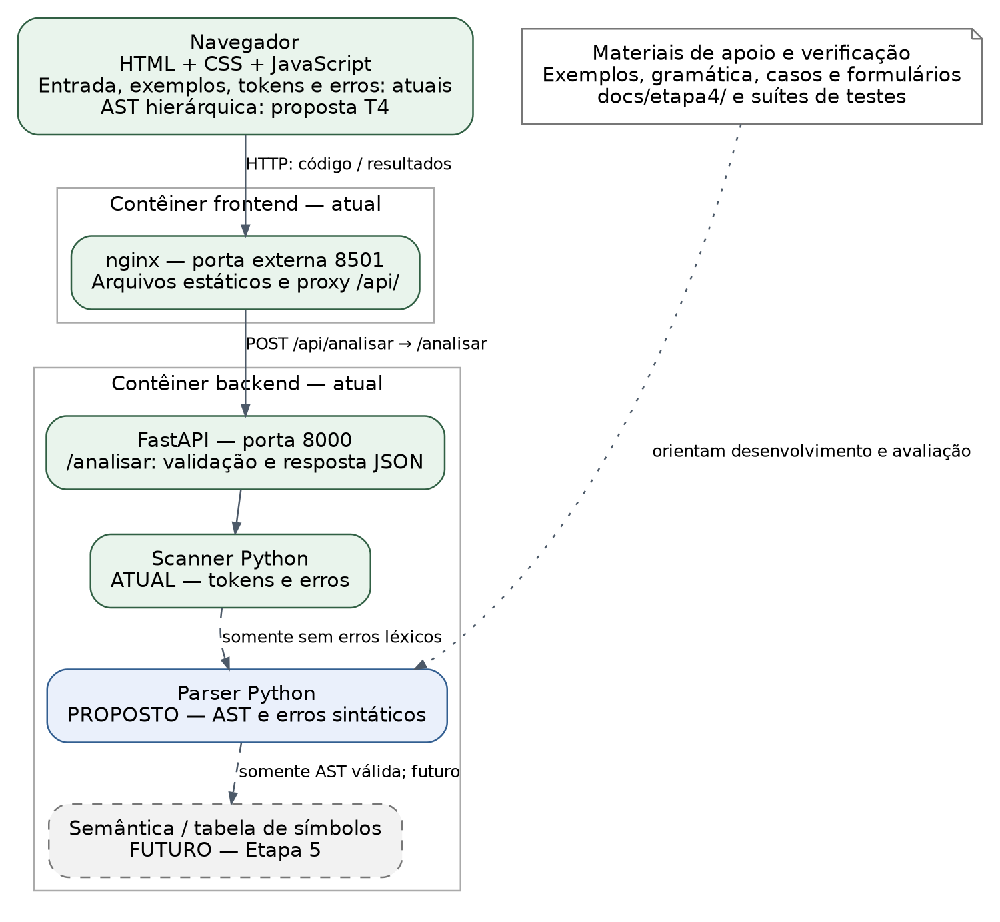
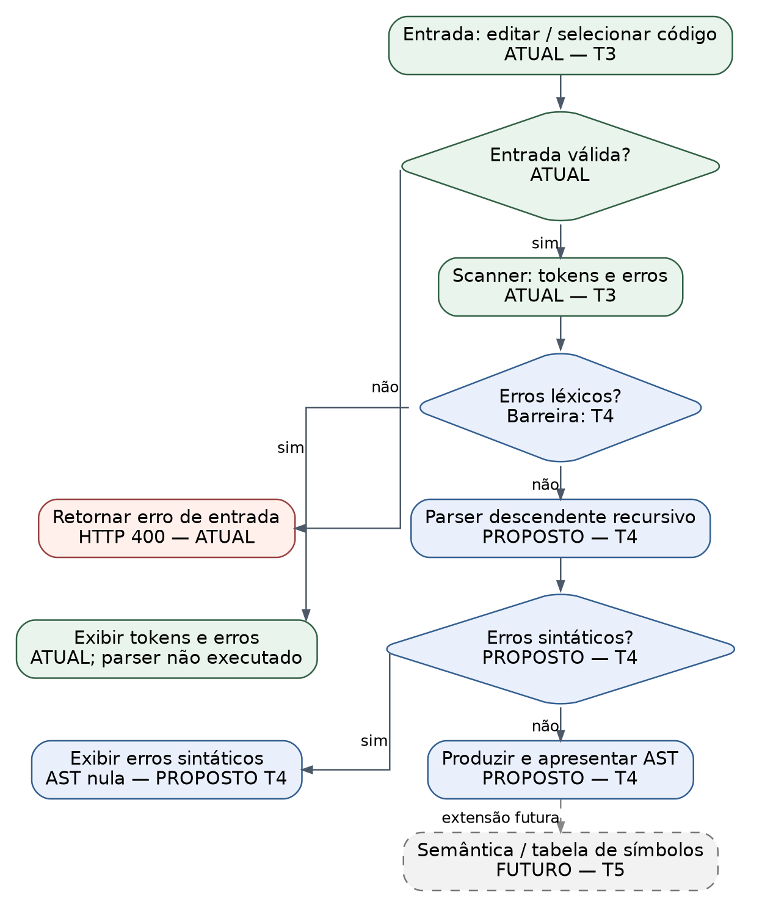

# Materiais e Métodos — Tarefa 4

Plano versão 1.0, 18/11/2026; parser e AST propostos, sem execução de novos testes.

## 3.1. Linguagem, escopo e público-alvo

O software tem como público prioritário estudantes de Computação ou Inteligência Artificial que estejam cursando ou já tenham cursado Compiladores. Propõe-se apoiar a relação entre código Mini-C, tokens e estrutura sintática. Professores poderão participar da avaliação como público distinto, sem misturar seus resultados aos de estudantes sem identificação do perfil.

A Mini-C do projeto não é uma implementação completa de C. O scanner já reconhece `int`, `float`, `if`, `else`, identificadores ASCII, números inteiros e reais decimais, operadores aritméticos, atribuição e relacionais, parênteses, chaves, ponto e vírgula e vírgula. Comentários de linha e bloco são ignorados. Strings, caracteres entre aspas, expoentes, hexadecimal, operadores lógicos e incremento estão fora do recorte atual.

Para o parser, propõem-se declarações simples com ou sem inicialização, atribuição, expressões, blocos e condicionais com blocos obrigatórios. Não serão incluídos laços, funções, arrays, ponteiros ou declaração múltipla por vírgula nesta proposta. Reconhecer a vírgula lexicalmente não obriga o parser a aceitar qualquer construção com vírgula. A escolha busca preservar os exemplos e os limites do projeto, sem ampliar o escopo apenas porque tais construções aparecem como exemplos no enunciado.

Os limites propostos são 10.000 caracteres, já aplicado à entrada, e 64 níveis de aninhamento estrutural ativo, a implementar e verificar. Esses valores são decisões de engenharia deste projeto, não limites derivados de experimento educacional. O limite de profundidade deverá considerar conjuntamente blocos, parênteses e operadores unários, com erro controlado antes de uma exceção de recursão.


### 3.1.1. Definições léxicas e gramática proposta

| Categoria | Definição no projeto |
|:--|:--|
| Reservadas | `int`, `float`, `if`, `else` |
| Identificador | `[A-Za-z_][A-Za-z0-9_]*` |
| Inteiro e real | `[0-9]+` e `[0-9]+\.[0-9]+` |
| Operadores | `+ - * / = == != < > <= >=` |
| Delimitadores | `( ) { } ; ,` |
| Comentários | `//` até fim da linha; `/* ... */` sem aninhamento |

Linha e coluna começam em 1, tab conta uma coluna e CR/CRLF são normalizados para LF no scanner. O sinal é um operador separado. `while` e outros nomes não reservados continuam sendo identificadores lexicalmente, mas não tornam a construção correspondente válida no parser.

```ebnf
(* Proposta v1.0 — 18/11/2026. Contrato planejado para o Trabalho 4; ainda não implementado. *)
programa     = item, { item }, EOF ;
item         = declaracao | atribuicao | condicional | bloco ;
declaracao   = tipo, IDENTIFICADOR, [ "=", expressao ], ";" ;
tipo         = "int" | "float" ;
atribuicao   = IDENTIFICADOR, "=", expressao, ";" ;
condicional  = "if", "(", expressao, ")", bloco, [ "else", bloco ] ;
bloco        = "{", { item }, "}" ;
expressao    = igualdade ;
igualdade    = relacional, { ( "==" | "!=" ), relacional } ;
relacional   = aditiva, { ( "<" | ">" | "<=" | ">=" ), aditiva } ;
aditiva      = multiplicativa, { ( "+" | "-" ), multiplicativa } ;
multiplicativa = unaria, { ( "*" | "/" ), unaria } ;
unaria       = ( "+" | "-" ), unaria | primaria ;
primaria     = IDENTIFICADOR | LITERAL_INTEIRO | LITERAL_REAL
             | "(", expressao, ")" ;
(* Operações binárias associam à esquerda em cada nível; unários, à direita.
   Blocos são obrigatórios em if/else. Não há atribuição dentro de expressão.
   EOF é marcador interno, não token adicional no contrato léxico existente.
   Espaços/comentários já são removidos pelo scanner, preservando posições.
   Não há semântica: nome não declarado e tipos não são decididos por estas regras.
   Programa só com comentários é vazio para o parser; bloco {} é um item válido. *)
```

O programa deve conter ao menos um item; blocos podem ser vazios. Portanto, comentário isolado é aceito lexicalmente, mas não constitui um programa na gramática proposta. Condicionais exigem blocos, evitando a associação ambígua de `else`. Operadores binários são associados à esquerda em cada nível e operadores unários à direita. Um par de sinais consecutivos, como `1 + -2`, pode ser válido; o caso inválido usa `1 + * 2` para não confundir sinal unário e erro.

## 3.2. Materiais e estado da implementação

A inspeção local utilizou o commit `040b296d68da9cf75f06492d5438f09c21767ed1`, correspondente à Etapa 3. Há HTML/CSS/JavaScript na interface, nginx no serviço frontend e Python/FastAPI no backend. O scanner é manual e não adiciona dependências de produção. Os manifestos fixam FastAPI 0.115.0, Uvicorn 0.30.6, pytest 8.3.3, httpx 0.27.2 e jsdom 24.1.0; as imagens definem Python 3.12 e Node 20 nos testes do frontend. Tags de imagens não constituem, por si só, versões imutáveis por digest.

A execução usa Docker Compose, porta 8501 na interface e 8000 na API. Os comandos já documentados são `docker compose up --build -d --wait` e `docker compose down`. O sistema não requer banco de dados. O ambiente inspecionado nesta preparação é Debian GNU/Linux 13, com Docker 28.4.0, Compose 2.40.3 e Chromium 154.0.8037.57. A validação futura está prevista em Chromium para desktop e viewport móvel; as versões efetivamente utilizadas deverão ser registradas na rodada de execução. A inspeção de versões não é apresentada como novo teste funcional do parser.

Estão implementados entrada/edição, seis exemplos, validação, scanner, tokens com posição, erros léxicos, contagem por categoria e navegação pela sequência de tokens. O registro da Etapa 3 contém resultados históricos; não é apresentado como execução do plano da Etapa 4.

O parser será proposto em Python, reutilizando os tokens; a árvore será apresentada inicialmente em formato hierárquico com HTML e controles nativos, evitando uma nova biblioteca gráfica como requisito inicial. Essa apresentação ainda não existe na aplicação. A validação técnica usará pytest, Node/jsdom e os testes de navegador opcionais em Playwright já disponíveis.


### 3.2.1. Programas de exemplo e origem

Os seis exemplos da interface foram elaborados no projeto e encontram-se em `frontend/index.html`; não são reproduções dos novos artigos. Seus resultados sintáticos abaixo são expectativas para a implementação futura.

| Exemplo | Objetivo e resultado esperado |
|:--|:--|
| Ex1: declaração | `int numero = 10;`: cinco tokens e AST com declaração inicializada |
| Ex2: aritmética | `int resultado = 10 + 5;`: soma no inicializador |
| Ex3: condicional | Declaração e `if (numero > 0) { ... }`: nó Se com bloco |
| Ex4: real e else | `float`, comparação `>=` e dois blocos: alternativa preservada |
| Ex5: comentários | Comentários não produzem tokens/nós; posições são preservadas |
| Ex6: recuperação | `12abc` e `@`: erros léxicos; tokens válidos preservados e parser não executado |

Os materiais de apoio incluem o guia inicial da interface, a especificação léxica já existente e a nova gramática, fluxograma, casos e formulário. Não se presume que um tutorial seja novidade: VERTO documenta ajuda e Borela et al. descrevem guia rápido.

## 3.3. Arquitetura e decisões técnicas

A interface envia `codigo` para `/api/analisar`; nginx encaminha ao FastAPI `/analisar`. Após validar a entrada, o backend executa o scanner existente. Havendo qualquer erro léxico, o parser não será executado. Serão mostrados tokens recuperados e erros léxicos, sem árvore que pareça validar um programa cuja entrada foi incompletamente reconhecida.

Na ausência de erros léxicos, um parser descendente recursivo reconhecerá comandos e expressões por níveis de precedência. Essa decisão permite relação direta entre regras e funções, escopo pequeno e testes de estruturas esperadas. Verto apresenta análise descendente recursiva manual, escolhida por simplicidade e relação com o projeto da linguagem (Schneider et al., 2005, p. 3 e 6); isso é referência de projeto, não prova de que a estratégia seja universalmente superior. A gramática, apresentada a seguir, também está disponível em `docs/etapa4/gramatica.ebnf`.

Para erros sintáticos, propõe-se indicar encontrado, esperado, linha e coluna, acumulando diagnósticos por recuperação em `;` e `}` quando possível. Todo caminho de recuperação deverá consumir entrada ou encerrar a análise. Se houver erro sintático, a resposta final terá AST nula; o parser não apresentará uma árvore parcial como resultado correto. O ponto EOF será calculado a partir do código normalizado, inclusive após comentários finais.

A AST usará nós `Programa`, `Declaracao`, `Atribuicao`, `Bloco`, `Se`, `Binario`, `Unario`, `Identificador` e `Literal`, com posições. Parênteses e pontuação não serão filhos estruturais; sua função aparecerá nas relações e na precedência. Literais preservarão o lexema original, sem executar expressões ou converter valores de forma que altere sua representação. Eventuais ajustes necessários à implementação serão versionados antes dos respectivos testes, preservando a rastreabilidade da proposta.

A interface deverá distinguir tokens, erros léxicos, erros sintáticos e AST. As decisões de associação entre representação e trecho de código têm referência nas interfaces de Graciano Junior et al. (2022, seções 5.1–5.2) e Borela et al. (2025, seção 3.2.3). Como esses recursos já aparecem na literatura, não constituem novidade exclusiva do projeto.

### 3.3.1. Contrato de comunicação proposto

A resposta manterá os campos atuais `recebido`, `sucesso`, `mensagem`, contagens, `tokens` e `erros`. Nesta compatibilidade, `sucesso` continua representando sucesso léxico; não será reinterpretado silenciosamente como validade de todas as fases. Propõe-se acrescentar:

```json
{
  "sintatica": {
    "estado": "nao_executada",
    "motivo": "erros_lexicos",
    "ast": null,
    "erros": []
  }
}
```

Quando o parser for executado, `estado` será `sucesso` ou `erro`. Em sucesso, a AST estará presente; em erro, será nula e haverá diagnósticos sintáticos. `motivo` só será necessário em análise não executada. Falhas de entrada continuam com HTTP 400; a análise processada com erros da linguagem mantém HTTP 200; exceção interna continua com HTTP 500 e mensagem genérica. Não serão expostos stack traces nem executado o programa enviado.

O contrato descreve a extensão planejada; a versão atual ainda devolve apenas o resultado léxico. Mudanças decorrentes da implementação serão registradas e terão testes de compatibilidade definidos antes de sua execução.


### 3.3.2. Componentes e responsabilidades

A Figura 1 representa os dois serviços Docker. O nginx fornece os arquivos da interface e encaminha a API; o FastAPI valida a entrada e coordena as fases. O scanner atual produz tokens/erros. O módulo de parser proposto consumirá esses tokens e construirá a AST; exemplos, gramática e casos formam materiais externos de apoio à implementação e avaliação. A semântica aparece somente como extensão futura.

{width=95%}

A AST será serializada em JSON e apresentada como hierarquia expandível, com rótulos e alternativas textuais. A seleção de nós deverá identificar a região associada ao código; os efeitos dessa interação serão verificados, não presumidos. Não se propõe animação dos estados internos do parser nesta versão.


### 3.3.3. Formato da AST e dos diagnósticos

O contrato estrutural proposto usa um campo `tipo` por nó e os seguintes campos específicos:

| Nó | Campos estruturais |
|:--|:--|
| `Programa` | `comandos`: lista ordenada de declarações e comandos |
| `Declaracao` | `tipoDado`, `nome`, `inicializador` (expressão ou nulo) |
| `Atribuicao` | `alvo` (Identificador), `valor` (expressão) |
| `Bloco` | `comandos`: lista ordenada |
| `Se` | `condicao`, `entao` (Bloco), `senao` (Bloco ou nulo) |
| `Binario` | `operador`, `esquerda`, `direita` |
| `Unario` | `operador`, `operando` |
| `Identificador` | `nome` |
| `Literal` | `categoria` (inteiro ou real), `lexema` |

Todos os nós terão `inicio` e `fim`, cada um com linha e coluna baseadas em 1; `fim` será exclusivo. O intervalo identifica o trecho da construção, enquanto o nome do operador preserva a estrutura abstrata. A categoria do literal é léxica e não substitui verificação semântica de tipos. Os oráculos de V04–V06 comparam somente a estrutura da expressão; posições são verificadas à parte.

Os diagnósticos em `sintatica.erros` deverão preservar tipo, lexema, posição, esperado, encontrado e mensagem. Por exemplo, em `int if;`, o parser deverá informar `ERRO_SINTATICO`, lexema `if`, linha 1, coluna 5, esperado `IDENTIFICADOR` e encontrado `PALAVRA_RESERVADA`. Em EOF, será usada a posição do fim do código normalizado e uma indicação explícita de fim de entrada. Essas estruturas ainda são propostas; não são atribuídas à resposta atual da Etapa 3.

## 3.4. Fluxo de funcionamento

A Figura 2 separa funções já implementadas, planejamento da Etapa 4 e extensões futuras da Etapa 5. A validação pode encerrar o fluxo com uma mensagem ao usuário. Tokens e erros léxicos permanecem visíveis, mesmo quando impedem a execução do parser. Com entrada lexicalmente reconhecida, a análise sintática deverá produzir AST ou erros separados. A etapa semântica é apenas uma extensão prevista após AST válida; não integra o caminho obrigatório da Etapa 4.

{width=88%}

O bloco “apresentação” não significa que o frontend atual já apresenta AST: tokens e erros léxicos existem; a apresentação dos resultados sintáticos é planejada. Cores são acompanhadas de rótulos para que o estado não dependa apenas da percepção de cor.

## 3.5. Critérios e casos de teste

Os arquivos `docs/etapa4/casos-de-teste.csv` e `docs/etapa4/gramatica.ebnf` formam a versão 1.0 do protocolo. O Apêndice A apresenta os 36 casos, sendo 33 aplicáveis ao plano da Etapa 4 e três semânticos futuros. Os casos são elaborados para este projeto, a partir de suas regras e exemplos; não são resultados copiados dos artigos. Todos os resultados observados permanecem vazios. Casos semânticos são previstos para a Etapa 5 e serão excluídos dos denominadores da Etapa 4.

| Critério | Verificação proposta |
|---|---|
| Correção léxica | Tipos, lexemas e posições comparados às saídas esperadas; manter regressão da Etapa 3 |
| Correção sintática | Aceitar cada caso válido e rejeitar cada inválido conforme a gramática, consumindo toda a entrada |
| AST | Comparação estrutural com árvore de referência, incluindo ordem de comandos, precedência e associatividade; posição verificada separadamente |
| Diagnósticos | Separar fases; identificar ponto do primeiro erro e conteúdo esperado/encontrado, sem exigir texto idêntico para todas as mensagens |
| Recuperação | Não travar; preservar tokens e acumular diagnósticos quando houver ponto seguro de sincronização |
| Consistência visual | Seleção e rótulos devem corresponder ao trecho e nó indicados, sem tratar uma árvore inválida como válida |
| Limites | Até 10.000 caracteres e 64 níveis conforme definição; excedentes geram erro controlado |
| Reprodutibilidade | Reconstruir imagens, iniciar serviços e executar um exemplo e um caso inválido usando os comandos documentados |
| Documentação | Incluir escopo, gramática, contrato, comandos, exemplos e limitações |

A aceitação técnica proposta requer todos os casos aplicáveis executados e aprovados, sem falha de regressão, acompanhada do registro das pendências. Cobertura de execução será `executados / planejados aplicáveis`; taxa de aprovação será `aprovados / executados`; prontidão também deverá informar `aprovados / planejados aplicáveis`. Assim, executar apenas os casos que passam não produz uma declaração falsa de conclusão.

Para AST, exemplos de referência incluem `1 + 2 * 3`, que deve ter soma na raiz e multiplicação no ramo direito, e `(1 + 2) * 3`, que deve ter multiplicação na raiz e soma no ramo esquerdo. `8 - 3 - 1` deverá associar à esquerda. Uma figura visualmente plausível não substitui essa comparação estrutural.

Os casos novos do parser não foram executados nesta tarefa acadêmica, pois o parser ainda não existe na base inspecionada. Se o plano mudar, um histórico registrará data, item alterado, motivo e quais resultados já eram conhecidos.


### 3.5.1. Origem dos critérios e critérios próprios

Correção léxica e sintática e inspeção de resultados seguem o objeto técnico de Graciano Junior et al. (2022, seções 5.1–5.2), VERTO (p. 3 e 6) e Jabri (2013, seção 4). Esses textos oferecem modelos de observação de processamento; não se afirma que tenham utilizado exatamente a suíte aqui proposta. Associação entre resultado e trecho de código tem referência em Borela et al. (2025, seção 3.2.3). O uso de perguntas de percepção e campos abertos se apoia em Borela et al. (seção 4), enquanto Mernik e Žumer (2003, seção 3) e Rodger et al. (2009, seção 2) ajudam a distinguir opinião e desempenho.

Comparação estrutural da AST, cobertura de casos, limites de entrada/profundidade, prevenção de execução após erro léxico e reprodução via Compose são critérios de engenharia definidos especificamente para Mini-C. Sua presença não é atribuída aos artigos quando não foi documentada. A análise semântica será avaliada somente na etapa correspondente, com política de tipos ainda a especificar.

### 3.5.2. Referências estruturais para a AST

As referências de V04–V06 fixam operadores e ordenação dos filhos, sem calcular a expressão pelo parser avaliado. Os objetos em `tests/planejamento/etapa4-ast-referencias.json` representam subárvores esperadas; campos de posição serão verificados separadamente. Chaves JSON não têm ordem significativa, mas os comandos do programa e os filhos esquerdo/direito têm.

## 3.6. Método de avaliação

### 3.6.1. Testes técnicos

As suítes existentes serão reexecutadas após as mudanças práticas, não nesta redação: `docker compose run --rm backend pytest -v`, `docker compose run --rm testes-frontend` e `bash scripts/smoke_test.sh`. Serão adicionados testes do parser, AST, limites, erros e contrato. Casos esperados deverão ser verificados sem derivar o resultado correto do próprio parser em teste.

Para a interface, pretende-se manter o teste opcional `python3 scripts/teste_navegador.py`, acrescentando visualização da AST e diagnósticos sintáticos. O teste em viewport móvel é simulação; não será generalizado como validação em todos os celulares. Registros deverão distinguir aprovação, falha, pendência, testes pulados e erro de infraestrutura.

### 3.6.2. Inspeção manual e avaliação por pares

O fluxo manual será inserir/selecionar código, analisar, localizar tokens e conferir AST ou diagnóstico. Entradas e resultados esperados serão definidos pelos casos; os resultados observados só serão preenchidos após uso real. Serão verificadas operação por teclado, foco, legibilidade dos rótulos e rolagem da árvore e da tabela.

Propõe-se uma amostra por conveniência, com meta inicial de 8 a 12 estudantes que estejam cursando ou já tenham cursado Compiladores e participação opcional de professores, analisados separadamente. Essa meta é uma decisão de viabilidade; não representa cálculo de poder estatístico. Uma avaliação piloto poderá ocorrer antes para identificar problemas do instrumento, com alterações documentadas antes da coleta principal. A participação será voluntária; nomes, e-mails e matrícula não serão coletados no formulário.

Borela et al. (2025, seção 4) utilizam questionário anônimo, perguntas em escala Likert e campos abertos. Essa é uma referência para a forma de coleta, não uma validação automática de um novo instrumento. Graciano Junior et al. (2022, seção 7.1) relatam apenas cinco respondentes e resultados não publicados, reforçando a necessidade de descrever o alcance da amostra e as perdas, sem prometer generalização.

As tarefas propostas são localizar um identificador, explicar um agrupamento de expressão pela AST, identificar um erro léxico, identificar um erro sintático e corrigir a entrada. O avaliador registrará conclusão, necessidade de ajuda e dificuldades. O formulário terá itens separados de usabilidade, clareza, contribuição percebida e recursos específicos do projeto.

### 3.6.3. Instrumento inicial

Escala para as afirmações: 1 = discordo totalmente; 2 = discordo; 3 = nem concordo nem discordo; 4 = concordo; 5 = concordo totalmente. Acrescentar “não se aplica/não consegui avaliar”, fora da escala. As perguntas são elaboração própria, inspiradas no formato de avaliação de Borela et al.; não são apresentadas como escala validada de usabilidade.

1. Entendi como inserir um programa e solicitar a análise.
2. Consegui localizar o tipo e o lexema de um token.
3. A indicação de linha e coluna ajudou a localizar o trecho no código.
4. Os controles para avançar e voltar entre tokens foram compreensíveis.
5. Consegui distinguir erro léxico de erro sintático.
6. O diagnóstico informou o que foi encontrado e o que era esperado.
7. A hierarquia da AST permitiu identificar a precedência da expressão.
8. A ligação entre o código e a representação selecionada foi clara.
9. Consegui ler os rótulos e navegar pela árvore sem perder o contexto.
10. Os exemplos em Mini-C e as explicações em português foram úteis para realizar as tarefas.
11. Consegui corrigir o erro e comparar a nova análise com a anterior.
12. Consegui operar as funções necessárias pelo teclado ou pelo dispositivo utilizado.
13. O software contribuiu para minha compreensão percebida das fases estudadas.

Os itens 3, 4, 8, 10 e 11 investigam componentes específicos da experiência proposta. Eles não pressupõem que tais recursos sejam exclusivos do software. Campos abertos: dificuldades/problemas encontrados e sugestões. Registrar apenas perfil acadêmico amplo e dispositivo utilizado. Se um recurso ainda não estiver disponível, usar não se aplica; não solicitar avaliação fictícia.

### 3.6.4. Análise e limites

Relatar número de convidados quando conhecido, participantes, respostas válidas e perdas. Para os itens, apresentar frequências e mediana; não calcular um escore de “aprendizagem” pela soma arbitrária de opiniões. Respostas não aplicáveis serão informadas e excluídas apenas do denominador de cada item. Comentários abertos serão organizados por tema com indicação de recorrência, sem identificar participantes.

Não se prevê nesta versão um experimento causal de aprendizagem. As respostas sobre compreensão medem percepção; não comprovam ganho cognitivo. Uma investigação futura de aprendizagem exigirá instrumento de conhecimento próprio e desenho explicitado. A amostra por conveniência, o uso de um recorte de linguagem e os dispositivos testados limitam generalização.


## 3.7. Limitações do método e do escopo

A proposta se aplica a um subconjunto didático, não à linguagem C completa. Não inclui execução do programa, otimização, geração de destino, laços ou funções, nem verificação semântica nesta etapa. Também não afirma conformidade integral com diretrizes de acessibilidade; os controles previstos serão examinados por inspeção e tarefas concretas.

O futuro estudo por conveniência poderá produzir opinião e evidências de realização de tarefas, sem demonstrar causalmente melhoria de aprendizagem. Nem a aprovação dos testes automatizados nem uma avaliação positiva da interface substituem um desenho de investigação de conhecimento. Aspectos não testados ou não aplicáveis serão mantidos explícitos nos relatórios.

# 4. Organização dos artefatos e continuidade

A proposta, gramática, figuras editáveis, matriz rastreável, casos e instrumento são disponibilizados em `docs/etapa4/` no repositório. O diretório `tests/planejamento/` contém a estrutura inicial de fixtures e referências de AST, com todos os casos novos ainda pendentes; não foi criada uma suíte fictícia de testes aprovados ou artificialmente pulados. As regras da Etapa 3 e seus resultados históricos permanecem preservados.

O Trabalho 4 implementará parser e apresentação da AST conforme esse plano, registrando eventuais mudanças antes de interpretar os respectivos resultados. O fluxograma não apresenta a semântica como concluída. Na Etapa 5, será necessário definir verificações, escopos e política de tipos antes de executar os casos semânticos previstos.

Repositório: <https://github.com/warner03/software-educacional-compiladores>. Base técnica examinada: commit `040b296`; documentação desta tarefa: pasta `docs/etapa4/`. O plano de avaliação versão 1.0 foi definido em 18 de novembro de 2026, antes dos novos resultados sintáticos.
