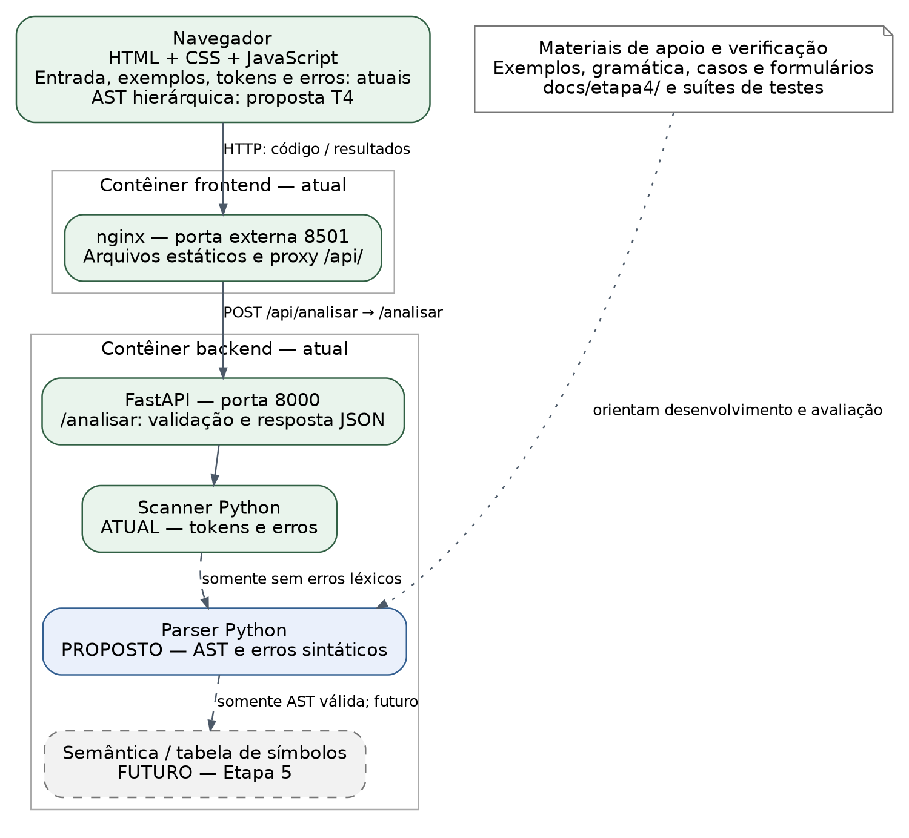
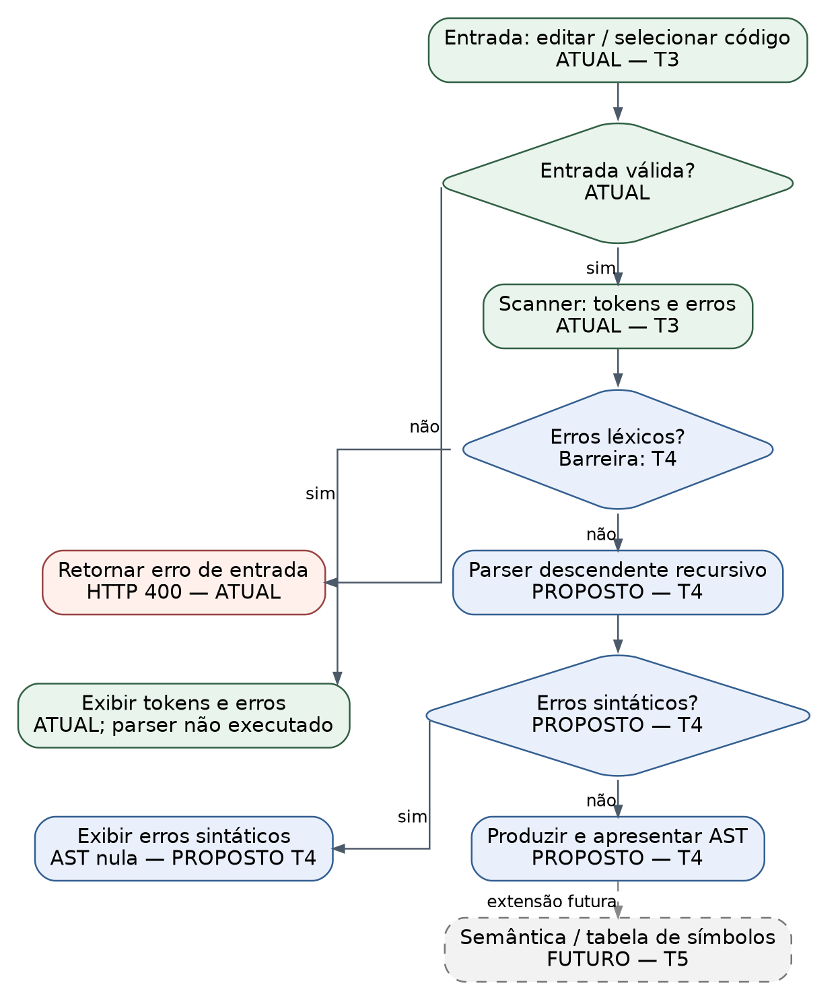

**Disciplina:** Compiladores\
**Professor:** Bruno Rocha\
**Natureza desta entrega:** proposta metodológica e plano de avaliação, definidos antes dos novos resultados do parser. A implementação prática permanece na Etapa 3; parser e AST são a próxima etapa de desenvolvimento.

# 1. Introdução

O estudo de compiladores articula linguagens formais, estruturas de dados e processamento de programas. Representações de tokens, regras e estruturas sintáticas podem aproximar os formalismos da execução dos analisadores, desde que as informações e as formas de interação sejam adequadas ao público. Visualizar uma etapa não demonstra, isoladamente, aprendizagem; é necessário distinguir implementação, usabilidade, opinião dos participantes e medidas de desempenho.

Ferramentas como LISA e VCOCO permitem acompanhar aspectos internos da análise, com estratégias diferentes de especificação e apresentação (Mernik; Žumer, 2003; Resler; Deaver, 1998). Entre os estudos nacionais, Graciano Junior et al. (2022) apresentam interação e explicações de análise léxica e sintática, enquanto Borela et al. (2025) oferecem artefatos de diferentes fases de compilação em interface web. Santini et al. (2022) contextualizam jogos de linguagens formais por meio de um mapeamento, sem propor um software único. JFLAP e Jeliot 3 ampliam a discussão sobre experimentação e visualização, respectivamente de modelos formais e de execução de programas (Rodger et al., 2009; Moreno et al., 2004).

Este projeto propõe um ambiente web para estudo das análises léxica e sintática de Mini-C. Sua contribuição pretendida está na organização de exemplos, diagnósticos e relações entre código e representações, dentro de um recorte da disciplina. Não se atribui exclusividade a interface web, documentação ou acompanhamento de passos, recursos já documentados em trabalhos anteriores.

A base prática da Etapa 3 já possui scanner integrado, posições, erros léxicos, tabela e navegação de tokens. Nesta tarefa acadêmica, a proposta passa a especificar a gramática, o parser, a AST, a arquitetura e os procedimentos de avaliação. As novas fontes são o compilador VERTO (Schneider et al., 2005), pertinente à organização modular e à análise descendente recursiva, e a ferramenta genérica de Jabri (2013), que permite contrastar uma abordagem orientada por gramáticas/autômatos com a estratégia delimitada de Mini-C.

# 2. Trabalhos relacionados e comparação revisada

## 2.1. Procedimento de seleção e conferência

A base cumulativa mantém os sete trabalhos das Etapas 1–3 e acrescenta duas novas publicações. A pesquisa foi orientada por pertinência ao ensino de compiladores, arquitetura, parsing e avaliação, utilizando portais oficiais, referências dos trabalhos anteriores e conferência de metadados em Crossref. A seleção é uma revisão narrativa orientada por critérios; não pretende esgotar a literatura nem produzir um ranking universal de ferramentas. Os dois novos textos foram lidos integralmente e estão reproduzidos nos Anexos A e B; os artigos antigos não são anexados novamente.

As classificações foram refeitas a partir dos textos originais disponíveis, em vez de utilizar a tabela de uma etapa anterior como fonte. Para LISA foi consultado o manuscrito fornecido, com 22 páginas; quando citadas suas páginas, trata-se dessa versão, não das páginas 61–68 da publicação IEEE. Para Borela et al., a localização utiliza as páginas internas 1–11 do PDF. Nos demais casos, informa-se a numeração impressa ou o número da página do arquivo, identificado na nota.

Foi utilizado apoio de inteligência artificial na localização, organização, conferência textual e redação. A rastreabilidade por critério, com fonte e localização, foi mantida para permitir a revisão crítica dos dados, em lugar de tratar respostas da ferramenta como evidência acadêmica.

## 2.2. Novo artigo 1 — Compilador Educativo VERTO

**Referência:** SCHNEIDER, Carlos Sérgio; PASSERINO, Liliana Maria; OLIVEIRA, Ricardo Ferreira de. Compilador Educativo VERTO: ambiente para aprendizagem de compiladores. *RENOTE*, v. 3, n. 2, p. 1–10, 2005. DOI: 10.22456/1679-1916.13949. O PDF assina Schneider; os metadados do portal registram Scheider. A divergência de grafia é mantida em nota na referência, sem criar dois estudos.

**Problema e objetivo.** O artigo discute as dificuldades de abordar, em uma disciplina semestral, tanto as análises quanto as fases de síntese do compilador. O tempo dedicado à compreensão de análise sintática pode limitar o estudo de geração de código. O objetivo é oferecer um projeto aberto e documentado que apoie a observação das transformações, sobretudo código intermediário e código-objeto (p. 1–3).

**Solução e escopo.** VERTO foi desenvolvido em Java, com fonte em português estruturado e sintaxe próxima a C, e gera código para a máquina didática César. A compilação produz primeiro um macro-assembler simplificado e depois o código de destino. O trabalho descreve scanner simples e parser descendente recursivo manual, escolhidos para facilitar a relação entre projeto da linguagem e implementação. A estrutura separa as fases em classes, conforme a nota iii, p. 9 (p. 3 e 6).

**Interação e recursos educacionais.** O estudante edita um programa e consulta abas com resultados. Há lista de tokens e lexemas, tabela de símbolos com tipos, endereços e escopo, regras sintáticas reconhecidas, movimentações da pilha semântica e código intermediário cujas linhas são comentadas. Um menu de ajuda apresenta sintaxe e rotinas. Essas saídas permitem relacionar construções a artefatos de compilação, mas o registro sequencial de regras não comprova controle interativo de avanço/retrocesso nem visualização de AST (p. 4–7).

**Método e resultados apresentados.** Trata-se de apresentação técnico-pedagógica da ferramenta, ilustrada por saídas e pelo exemplo de execução de fatorial na máquina César. O texto relata exploração de seus recursos por alunos em disciplinas, mas não apresenta protocolo de avaliação com amostra, questionário quantificado, pré/pós-teste ou comparação controlada de aprendizagem. As possibilidades de aprendizagem contextualizada são fundamentação e interpretação pedagógica dos autores, não medidas de eficácia demonstradas por experimento próprio (p. 5–9).

**Limitações e crítica.** O foco em síntese, a linguagem educacional reduzida e o vínculo ao ambiente César delimitam o contexto de uso; não são defeitos por si mesmos. Os recursos descritos não demonstram funcionamento em navegador, responsividade ou acessibilidade. Embora sejam exibidos registros de processamento, não se deve transformar qualquer saída textual em animação de execução ou em uma árvore sintática abstrata. Também não cabe inferir que todos os benefícios educacionais discutidos foram medidos (p. 3–9).

**Relação com Mini-C.** O estudo sustenta a decisão de preservar módulos separados e considerar um parser descendente recursivo manual para um subconjunto pequeno. O projeto adapta a ideia de aproximar resultados do código, mas prioriza tokens, diagnósticos e AST, em vez de gerar código para César. A referência não implica reproduzir todo o VERTO nem comprova superioridade da estratégia escolhida.

## 2.3. Novo artigo 2 — A Generic Tool for Teaching Compilers

**Referência:** JABRI, Riad. A Generic Tool for Teaching Compilers. *Computer and Information Science*, v. 6, n. 2, p. 134–150, 2013. DOI: 10.5539/cis.v6n2p134.

**Problema e objetivo.** O trabalho investiga a transição entre teoria de scanning/parsing e construção de analisadores, considerando as dificuldades de combinar ferramentas e representações. Propõe uma abordagem genérica que utiliza gramáticas anotadas e autômatos para aproximar reconhecimento léxico, sintático e tradução dirigida pela sintaxe (p. 134–136).

**Solução e funcionalidades.** A proposta define um autômato genérico aumentado, sua transformação para uma representação reduzida e um simulador. Conforme a instanciação por definições regulares ou gramáticas livres de contexto, o mecanismo é apresentado como scanner, parser ou tradutor. O artigo descreve algoritmos, tabelas de transição/redução, exemplos de reconhecimento e esquemas de tradução. A saída inclui estados, grafos e ações de redução; um grafo de estados não é AST, e as tabelas do parser não são uma tabela de símbolos de identificadores (seção 3, p. 136–145).

**Recursos didáticos.** O estudante fornece símbolos e produções, observa o autômato e as tabelas e realiza exercícios de construção. Os exemplos explicam relações entre gramática, representação e reconhecimento. O texto demonstra rastros tabulares, mas não documenta controles de animação e retorno equivalentes aos do JFLAP ou Jeliot. A descrição de algoritmos no artigo também não confirma, sozinha, explicações conceituais integradas à interface (p. 144–149).

**Método de avaliação.** A fase de parsing foi escolhida como caso representativo e implementada em Microsoft Visual C++ 6.0. O autor relata uso por estudantes de três turmas ao longo de três semestres e comparação com abordagens como SLR em exercícios. Informa aumento de 30% no número de alunos que concluíram os trabalhos em comparação com semestres anteriores, sem detalhar denominadores, características das turmas ou teste estatístico. Esse indicador está relacionado à conclusão de atividades, não equivale a uma medida direta e controlada de aprendizagem (seção 4, p. 146–147).

**Resultados e limites.** Para uma gramática de exemplo, o artigo compara oito estados na abordagem proposta a quinze em SLR. Esse resultado se refere ao exemplo apresentado e não prova menor custo para toda gramática ou uma vantagem universal de usabilidade. A conclusão anuncia novos experimentos para fases subsequentes, como geração de código; portanto, a arquitetura genérica e exemplos de tradução não são tratados como validação completa de todas as fases (seções 5–6, p. 148–149).

**Relação com Mini-C e crítica.** A principal contribuição para este projeto é exigir correspondência explícita entre gramática, algoritmo, representação e saída esperada. A abordagem de Jabri não será implementada em Mini-C: o escopo e a base Python favorecem funções descendentes recursivas e testes diretos da AST. O estudo também alerta para separar uma demonstração algorítmica de uma avaliação educacional: contagem de estados e conclusão de trabalhos não substituem observação de interação nem testes de conhecimento. A pertinência do artigo está no projeto e na verificação de analisadores, mesmo sem documentar a mesma experiência de interface proposta aqui.

## 2.4. Correções incorporadas aos trabalhos anteriores

A releitura confirmou que Graciano Junior et al. (2022) apresentam entrada de código, explicações e controle de passos, além de testes preliminares com cinco alunos. Os resultados do formulário não foram publicados devido ao pequeno número de respondentes; isso não elimina a ocorrência de avaliação (seções 4 e 7.1, p. 227 e 233). Em Borela et al. (2025), editor, exemplos, tokens e tabela de símbolos são explícitos, e o artigo afirma não incluir passo a passo da árvore (seção 2 e seção 3.2.3). Sua estrutura é denominada árvore de derivação; a matriz não a renomeia automaticamente como AST.

Mernik e Žumer (2003) apresentam questionários na tabela I e comparam médias de notas de 8,05 e 8,6 em turmas de anos distintos. Assim, há avaliação e medida observacional de desempenho, embora não seja demonstrada causalidade nem informado o tamanho da amostra no texto consultado (seção 3, p. 18–20 do manuscrito). O artigo também apresenta emissão de instruções para uma máquina de pilha, aspecto ausente da classificação anterior. Já Resler e Deaver (1998) não relatam avaliação com estudantes nem a anunciam como futura: nessa questão, a classificação correta é NI. Sua arquitetura é orientada à portabilidade; não se sustenta descrevê-la como estritamente limitada ao Windows.

Foram corrigidos os DOI de Borela et al. (10.5753/wei.2025.7407), Santini et al. (10.5753/sbgames_estendido.2022.226064) e VCOCO (10.1145/282991.283123). No último caso, o identificador anterior correspondia a outro artigo. Os sete registros foram preservados, com revisão de seus dados em vez de exclusão.

## 2.5. Matriz cumulativa de características

**Legenda:** ✓ = presença confirmada; ✗ = ausência explicitamente documentada na versão estudada; **NI** = informação não identificada ou insuficiente, sem inferir ausência; **N/A** = critério não aplicável ao objeto definido. As três partes têm as mesmas nove referências, sem colunas separadas de ano ou nome de software.

**Critérios operacionais.** Web significa uso em navegador, não apenas código escrito em Java. Entrada significa entrada/edição de programa-fonte de uma linguagem-alvo; ferramentas aqui examinadas como sistemas de gramáticas/cadeias têm esse critério explicitado em observação. Exemplos são recursos fornecidos para experimentação, não qualquer código impresso em uma figura. Passos exige acompanhamento controlado ou animado de transformações, e não só artefatos finais. Diagnóstico inclui sinalização de erro, cuja clareza/localização é descrita separadamente. Explicações pode incluir tutorial ou guia associado. Tabela de símbolos exige apresentação de identificadores/atributos, sem confundir tabelas de parsing ou valores de execução com essa estrutura.

Foi acrescentada **árvore de derivação** para distinguir um recurso frequente de AST. A AST exige representação abstrata ou estrutura equivalente claramente identificada; árvore com produções e pontuação gramatical não é automaticamente AST. A coluna Aprendizagem registra medidas de conhecimento e indicadores de desempenho acadêmico, como notas ou conclusão de trabalhos, distinguindo indicadores indiretos de testes de conhecimento e de opinião positiva. Suas marcações não indicam causalidade nem superioridade educacional.

### 2.5.1. Interface, entrada e estruturas

| Referência | Web | Entrada | Exemplos | Léxica | Sintática | AST | Árv. deriv. |
|:--|:--:|:--:|:--:|:--:|:--:|:--:|:--:|
| Graciano Junior et al. (2022) [R1] | ✓ | ✓ | NI | ✓ | ✓ | NI | ✓ |
| Borela et al. (2025) [R2] | ✓ | ✓ | ✓ | ✓ | ✓ | NI | ✓ |
| Santini et al. (2022) [R3] | N/A | N/A | N/A | N/A | N/A | N/A | N/A |
| Mernik e Žumer (2003) [R4] | NI | ✓ | ✓ | ✓ | ✓ | NI | ✓ |
| Resler e Deaver (1998) [R5] | NI | ✓ | NI | ✓ | ✓ | NI | NI |
| Rodger et al. (2009) [R6] | NI | N/A | ✓ | NI | ✓ | NI | ✓ |
| Moreno et al. (2004) [R7] | NI | ✓ | NI | NI | NI | NI | NI |
| Schneider et al. (2005) [R8] | NI | ✓ | NI | ✓ | ✓ | NI | NI |
| Jabri (2013) [R9] | NI | N/A | NI | ✓ | ✓ | NI | NI |

### 2.5.2. Processamento e apoio didático

| Referência | Semânt. | Símb. | Geração | Passos | Diag. | Explic. |
|:--|:--:|:--:|:--:|:--:|:--:|:--:|
| Graciano Junior et al. (2022) [R1] | ✗ | NI | ✗ | ✓ | ✓ | ✓ |
| Borela et al. (2025) [R2] | ✓ | ✓ | ✓ | ✗ | NI | ✓ |
| Santini et al. (2022) [R3] | N/A | N/A | N/A | N/A | N/A | N/A |
| Mernik e Žumer (2003) [R4] | ✓ | NI | ✓ | ✓ | ✓ | NI |
| Resler e Deaver (1998) [R5] | NI | NI | NI | ✓ | NI | NI |
| Rodger et al. (2009) [R6] | NI | NI | NI | ✓ | NI | ✓ |
| Moreno et al. (2004) [R7] | NI | NI | NI | ✓ | ✓ | ✓ |
| Schneider et al. (2005) [R8] | ✓ | ✓ | ✓ | NI | NI | ✓ |
| Jabri (2013) [R9] | NI | NI | NI | NI | ✓ | NI |

### 2.5.3. Evidências de avaliação

| Referência | Estudantes | Aprendizagem |
|:--|:--:|:--:|
| Graciano Junior et al. (2022) [R1] | ✓ | NI |
| Borela et al. (2025) [R2] | ✓ | NI |
| Santini et al. (2022) [R3] | N/A | N/A |
| Mernik e Žumer (2003) [R4] | ✓ | ✓ |
| Resler e Deaver (1998) [R5] | NI | NI |
| Rodger et al. (2009) [R6] | ✓ | ✓ |
| Moreno et al. (2004) [R7] | ✗ | ✗ |
| Schneider et al. (2005) [R8] | NI | NI |
| Jabri (2013) [R9] | ✓ | ✓ |

Santini et al. são mantidos como estudo secundário: as funcionalidades dos nove jogos não são somadas como se existissem em uma ferramenta única. Para LISA, Aprendizagem indica a comparação de médias entre anos; para JFLAP, indica os pré/pós-testes sem diferença significativa entre grupos. Para Jeliot 3, as ausências de avaliação referem-se à versão 3, cuja primeira avaliação é indicada como futura, sem negar estudos sobre versões anteriores. Em Jabri, a presença indica o aumento reportado na conclusão de trabalhos, um indicador acadêmico indireto; não é equiparado a teste de conhecimento.

### 2.5.4. Fontes das classificações

Cada presença/ausência acima possui uma justificativa abaixo. O arquivo `docs/etapa4/matriz-evidencias.csv` registra também NI e N/A, uma linha por combinação de referência e critério, permitindo conferir as 135 células.

**[R1] Graciano Junior et al. (2022).** Pseudolinguagem baseada em Portugol. Resultados do formulário não publicados pelo pequeno número de respondentes; não se infere aprendizagem. Manual com exemplos é descrito como melhoria futura, não como recurso confirmado da versão.

- **Web:** Resumo, p. 224: aplicação web responsiva.
- **Entrada:** Seção 5.1, p. 228, figura 3: campo editável de código próprio.
- **Léxica:** Seção 5.1, p. 228–229: lista de tokens e animação do autômato.
- **Sintática:** Seção 5.2, p. 229–232: parser preditivo e regras de derivação.
- **Derivação:** Seção 5.2, p. 231–232, figuras 9–11: árvore de derivação.
- **Semânt.:** Seção 7.1, p. 233: módulo semântico indicado como futuro.
- **Geração:** Seção 7.1, p. 233: geração de código intermediário indicada como futura.
- **Passos:** Seções 5.1–5.2, p. 228–232: próximo/anterior e animações.
- **Diag.:** Seção 5.1, p. 229: mensagem com estado e caractere causador; seção 5.2, p. 232: erro destacado.
- **Explic.:** Seções 5.1–5.2, p. 228–229: abas teóricas e explicações do processamento.
- **Estudantes:** Seções 4 e 7.1, p. 227 e 233: cinco alunos testaram e preencheram formulário.

**[R2] Borela et al. (2025).** Linguagem inspirada em C. AST não é confirmada por simples equivalência com a árvore de derivação do ANTLR. Aceitação 4,81/5 não é medida de conhecimento. Paginação usada: 1–11 do PDF; anais: 171–181.

- **Web:** Seção 3.1, p. 4 do PDF: arquitetura cliente-servidor web.
- **Entrada:** Seção 3.2.3, p. 7 do PDF: editor de código.
- **Exemplos:** Seção 3.2.3, p. 7: botão com exemplos básicos, recursão, ordenação e jogos.
- **Léxica:** Seção 3.2.2, p. 6, e seção 3.2.3, p. 7: ANTLR e lista de tokens.
- **Sintática:** Seção 3.2.2, p. 6: analisador sintático gerado por ANTLR.
- **Derivação:** Seção 3.2.2, p. 6: a estrutura gerada é denominada árvore de derivação.
- **Semânt.:** Quadro 1, p. 3, e seção 3.2.1, p. 5: todas as etapas e regras de tipos/conversões implícitas; não se infere catálogo completo de verificações.
- **Símb.:** Seções 3.2.2–3.2.3, p. 6–7: tabela em JSON e tela com funções, escopos e strings.
- **Geração:** Seções 3.2.2–3.2.3, p. 6–8: LLVM IR, Assembly e código-alvo.
- **Passos:** Seção 2, p. 3: autores explicitam que não incluem passo a passo da árvore.
- **Explic.:** Seção 3.2.3, p. 7: menu com informações da linguagem, funcionando como guia rápido.
- **Estudantes:** Seção 4, p. 8–9: 27 respostas, com estudantes, professores e outros participantes.

**[R3] Santini et al. (2022).** Mapeamento de nove jogos, não um software único. N/A refere-se às funcionalidades e à avaliação própria de uma ferramenta. Os estudos primários são discutidos no texto, sem união artificial de suas características.


**[R4] Mernik e Žumer (2003).** Foi consultado o manuscrito fornecido de 22 páginas, correspondente ao artigo IEEE p. 61–68. Notas são evidência observacional, sem demonstração causal; número de participantes não informado. Uso interno de inEnv/outEnv não confirma uma tela de tabela de símbolos.

- **Entrada:** Seção 1, p. 5 do manuscrito: IDE permite especificar e executar programas; figura 1, p. 6.
- **Exemplos:** Seção 3, p. 12–17: linguagens e programas fornecidos aos estudantes; p. 19: biblioteca de linguagens.
- **Léxica:** Seção 2.1, p. 8–9: expressões regulares, DFA e scanner.
- **Sintática:** Seção 2.2, p. 9–10; seção 3, p. 12: analisadores LL(k)/LR(k).
- **Derivação:** Seção 2.2, p. 10, figura 4: construção da árvore a partir da gramática.
- **Semânt.:** Seção 2.3, p. 10–11: gramáticas de atributos e avaliação semântica.
- **Geração:** Seção 3, p. 17, figura 10: código PUSH/MUL/ADD emitido para expressões.
- **Passos:** Seção 2.3, p. 11: execução em passos e breakpoints; seções 2.1–2.2: animações.
- **Diag.:** Figura 3, p. 9: mensagem de erro léxico quando não há transição.
- **Estudantes:** Seção 3, p. 18: questionários preenchidos após a disciplina, tabela I.
- **Aprendizagem:** Seção 3, p. 19–20: média de notas 8,05 sem LISA e 8,6 com LISA, em turmas de anos distintos.

**[R5] Resler e Deaver (1998).** VCOCO significa Visible Compiler Compiler. O artigo enfatiza portabilidade e admite browser como possibilidade de frontend, sem documentar uma versão web pronta. Não relata avaliação com estudantes nem a anuncia como futura. Animações de árvore mencionadas para gyacc são trabalho relacionado, não recurso transferível ao VCOCO.

- **Entrada:** Seção 3, p. 199–200: programa-fonte compilado é mostrado na janela Source, com lexemas reconhecidos.
- **Léxica:** Seção 3, p. 200: scanner, isolamento de lexemas e reconhecimento de tokens.
- **Sintática:** Resumo e seção 2, p. 199: compiladores LL(1); seção 3, p. 200: acompanhamento do parser.
- **Passos:** Seção 3, p. 200: single-step, breakpoints e observação de variáveis.

**[R6] Rodger et al. (2009).** A entrada examinada é de gramáticas/autômatos e cadeias formais, não um editor de programas de uma linguagem-alvo; por isso Entrada é N/A. Simulação de autômato não confirma tokenização de programas. Medidas de aprendizagem presentes não significam ganho causal comprovado.

- **Exemplos:** Seções 3.4–3.5, p. 406: exemplos e arquivos do tutorial disponíveis para download.
- **Sintática:** Seções 3.1–3.2, p. 405–406: LL(1), SLR(1), CYK e parser controlado pelo usuário.
- **Derivação:** Seção 3.1, p. 406, figura 1: árvore de derivação.
- **Passos:** Seção 3.1, p. 406: escolha de regras, avanço e retrocesso.
- **Explic.:** Seções 3.5 e 4, p. 406: tutorial didático associado.
- **Estudantes:** Seções 2.1–2.3, p. 404–405: estudo com estudantes e docentes de diferentes instituições.
- **Aprendizagem:** Seção 2.3, p. 405: pré/pós-testes; diferença entre grupo de controle e grupo JFLAP não significativa.

**[R7] Moreno et al. (2004).** O objeto é visualização de execução Java para iniciantes. Representação intermediária de eventos da animação não é código intermediário de compilação apresentado didaticamente. Uso de navegador na história da família refere-se a Jeliot I, não confirma Web para Jeliot 3.

- **Entrada:** Seção 4.2, p. 375: editor e visualização de código.
- **Passos:** Seção 4.4, p. 376: executar, pausar, retornar e passo a passo da execução.
- **Diag.:** Seção 4.2, p. 375: erro e região do código associada.
- **Explic.:** Seção 4.3, p. 375: explicações junto às expressões.
- **Estudantes:** Seção 5, p. 376: primeira avaliação de Jeliot 3 descrita como futura; não atribuir estudos de versões anteriores à versão 3.
- **Aprendizagem:** Seção 5, p. 376: resultados da primeira avaliação de Jeliot 3 ainda não apresentados.

**[R8] Schneider et al. (2005).** Foco nas fases de síntese. Registros sequenciais de regras não confirmam controles interativos de passo a passo. Uso em disciplinas é relatado na p. 9, sem protocolo de avaliação/medidas de aprendizagem. O PDF assina Schneider; o portal e Crossref registram Scheider.

- **Entrada:** p. 4, figura 2: janela de edição de texto-fonte.
- **Léxica:** p. 6: apresentação dos tokens e lexemas.
- **Sintática:** p. 3 e 6: análise descendente recursiva e registro de regras reconhecidas.
- **Semânt.:** p. 7: ações e pilha semântica; p. 9: tratamento de tipos.
- **Símb.:** p. 6: aba com identificadores, tipos, endereços e escopo.
- **Geração:** p. 3–4: macro-assembler e código para máquina César.
- **Explic.:** p. 4: linhas de código intermediário comentadas; p. 5: ajuda sobre sintaxe e rotinas.

**[R9] Jabri (2013).** Ferramenta genérica de gramáticas e autômatos; Entrada de programa-alvo é N/A nesse recorte. O autor reporta +30% na conclusão de trabalhos, sem denominadores detalhados; trata-se de indicador acadêmico indireto, não de teste de conhecimento. Descreve esquemas de tradução, mas a validação enfatiza parsing e deixa novos experimentos de geração de código para o futuro; não se marca geração completa como confirmada.

- **Léxica:** Seção 3.2, p. 142, exemplo 6 e tabela 2, p. 144: simulação que produz tokens.
- **Sintática:** Seção 4, p. 146–147: implementação e experimento de construção de parser.
- **Diag.:** Algoritmo 3, p. 144: sinalização Error quando não há transição; não confirma diagnóstico localizado ou didático.
- **Estudantes:** Seção 4, p. 146: uso por estudantes de três turmas ao longo de três semestres.
- **Aprendizagem:** Seção 4, p. 146: aumento reportado de 30% na conclusão de trabalhos; indicador acadêmico indireto, sem medida de conhecimento ou denominadores detalhados.


## 2.6. Análise comparativa

Os estudos têm objetos diferentes. LISA e VCOCO apoiam a especificação e o acompanhamento de compiladores; JFLAP explora modelos formais e parsing; Jeliot 3 visualiza execução Java; VERTO enfatiza a síntese e o código de destino; Jabri investiga uma construção genérica de analisadores. O mapeamento de Santini et al. fornece contexto de pesquisa, não um concorrente funcional. Essa diversidade torna inadequado somar marcações para proclamar uma solução vencedora.

Há convergência em tornar algum processamento observável, mas as representações não são intercambiáveis. Árvore de derivação, AST, grafo de autômato, tabelas do parser e animação de valores cumprem papéis distintos. A ausência de AST confirmada nos textos consultados não prova que nenhuma dessas ferramentas ou versões posteriores a ofereça. Para Mini-C, a AST é uma decisão de representação coerente com precedência e estrutura de comandos; sua correção deverá ser comparada com referências estruturais.

No plano de IHC, Graciano Junior et al. articulam teoria, exemplos de processamento e controles; Borela et al. associam tokens/nós a trechos do código; Jeliot 3 utiliza consistência espacial, explicações próximas das expressões e controle da animação. VERTO documenta ajuda de sintaxe e linhas comentadas. Logo, documentação, tutoriais e associação entre código e resultado não serão anunciados como funcionalidades inéditas de Mini-C. Sua adaptação ao recorte do projeto é uma contribuição a implementar e examinar.

As restrições relatadas afetam o método. No JFLAP, a rejeição de cadeias sem explicação motivou novas formas de exploração; isso sugere examinar a clareza de diagnósticos, e não apenas contar erros detectados. Em Jabri, informações de gramática e autômato orientam construção de analisadores, mas não substituem um estudo da interação de iniciantes. A escolha do parser recursivo para Mini-C é uma adequação de escopo e manutenção, não uma conclusão de inferioridade dos algoritmos alternativos.

Quanto a dispositivos, Graciano Junior et al. declaram responsividade e possibilidade de uso móvel, mas não apresentam uma avaliação específica de tarefas por dispositivo. Nos demais textos, não foram confirmados estudos de interação por toque ou de acessibilidade completos. Não se presume que Web signifique boa experiência móvel. A proposta prioriza computador em laboratório ou estudo remoto e prevê inspeção em tela estreita e por teclado, registrando os dispositivos efetivamente usados.

As formas de avaliação também diferem. Graciano Junior et al. relatam um piloto pequeno; Borela et al. utilizam questionário com público misto; LISA combina percepção e médias de notas de anos distintos; JFLAP aplica testes e questionários, sem diferença estatística significativa entre grupos no teste de conhecimento; Jabri relata conclusão de trabalhos. Esses desenhos sustentam conclusões diferentes. Nenhum deles permite atribuir antecipadamente um ganho de aprendizagem ao projeto Mini-C.

## 2.7. Diferencial pretendido

O projeto pretende oferecer uma sequência de estudo em português que mantenha relacionados código, tokens, posições e AST de um recorte pequeno de Mini-C, com mensagens separadas por fase e exemplos editáveis. O acompanhamento dos tokens já existe; a árvore e os diagnósticos sintáticos serão desenvolvidos no Trabalho 4. O diferencial pretendido é a adequação dessa experiência ao conteúdo e público do projeto, não exclusividade de seus componentes.

Sua verificação exige casos conhecidos, árvores de referência e tarefas de uso. O plano inclui avaliar se o estudante localiza o trecho indicado, distingue erro léxico de sintático e interpreta um agrupamento pela AST. Docker Compose organiza a reprodução do ambiente, mas não comprova, por si só, usabilidade, aprendizagem ou implantação em qualquer máquina. A literatura examinada também contém arquitetura e documentação; tais artefatos serão produzidos por sua utilidade e rastreabilidade, sem alegar uma lacuna universal não demonstrada.

# 3. Materiais e Métodos

## 3.1. Linguagem, escopo e público-alvo

O software tem como público prioritário estudantes de Computação ou Inteligência Artificial que estejam cursando ou já tenham cursado Compiladores. Propõe-se apoiar a relação entre código Mini-C, tokens e estrutura sintática. Professores poderão participar da avaliação como público distinto, sem misturar seus resultados aos de estudantes sem identificação do perfil.

A Mini-C do projeto não é uma implementação completa de C. O scanner já reconhece `int`, `float`, `if`, `else`, identificadores ASCII, números inteiros e reais decimais, operadores aritméticos, atribuição e relacionais, parênteses, chaves, ponto e vírgula e vírgula. Comentários de linha e bloco são ignorados. Strings, caracteres entre aspas, expoentes, hexadecimal, operadores lógicos e incremento estão fora do recorte atual.

Para o parser, propõem-se declarações simples com ou sem inicialização, atribuição, expressões, blocos e condicionais com blocos obrigatórios. Não serão incluídos laços, funções, arrays, ponteiros ou declaração múltipla por vírgula nesta proposta. Reconhecer a vírgula lexicalmente não obriga o parser a aceitar qualquer construção com vírgula. A escolha busca preservar os exemplos e os limites do projeto, sem ampliar o escopo apenas porque tais construções aparecem como exemplos no enunciado.

Os limites propostos são 10.000 caracteres, já aplicado à entrada, e 64 níveis de aninhamento estrutural ativo, a implementar e verificar. Esses valores são decisões de engenharia deste projeto, não limites derivados de experimento educacional. O limite de profundidade deverá considerar conjuntamente blocos, parênteses e operadores unários, com erro controlado antes de uma exceção de recursão.


### 3.1.1. Definições léxicas e gramática proposta

| Categoria | Definição no projeto |
|:--|:--|
| Reservadas | `int`, `float`, `if`, `else` |
| Identificador | `[A-Za-z_][A-Za-z0-9_]*` |
| Inteiro e real | `[0-9]+` e `[0-9]+\.[0-9]+` |
| Operadores | `+ - * / = == != < > <= >=` |
| Delimitadores | `( ) { } ; ,` |
| Comentários | `//` até fim da linha; `/* ... */` sem aninhamento |

Linha e coluna começam em 1, tab conta uma coluna e CR/CRLF são normalizados para LF no scanner. O sinal é um operador separado. `while` e outros nomes não reservados continuam sendo identificadores lexicalmente, mas não tornam a construção correspondente válida no parser.

```ebnf
(* Proposta v1.0 — 18/11/2026. Contrato planejado para o Trabalho 4; ainda não implementado. *)
programa     = item, { item }, EOF ;
item         = declaracao | atribuicao | condicional | bloco ;
declaracao   = tipo, IDENTIFICADOR, [ "=", expressao ], ";" ;
tipo         = "int" | "float" ;
atribuicao   = IDENTIFICADOR, "=", expressao, ";" ;
condicional  = "if", "(", expressao, ")", bloco, [ "else", bloco ] ;
bloco        = "{", { item }, "}" ;
expressao    = igualdade ;
igualdade    = relacional, { ( "==" | "!=" ), relacional } ;
relacional   = aditiva, { ( "<" | ">" | "<=" | ">=" ), aditiva } ;
aditiva      = multiplicativa, { ( "+" | "-" ), multiplicativa } ;
multiplicativa = unaria, { ( "*" | "/" ), unaria } ;
unaria       = ( "+" | "-" ), unaria | primaria ;
primaria     = IDENTIFICADOR | LITERAL_INTEIRO | LITERAL_REAL
             | "(", expressao, ")" ;
(* Operações binárias associam à esquerda em cada nível; unários, à direita.
   Blocos são obrigatórios em if/else. Não há atribuição dentro de expressão.
   EOF é marcador interno, não token adicional no contrato léxico existente.
   Espaços/comentários já são removidos pelo scanner, preservando posições.
   Não há semântica: nome não declarado e tipos não são decididos por estas regras.
   Programa só com comentários é vazio para o parser; bloco {} é um item válido. *)
```

O programa deve conter ao menos um item; blocos podem ser vazios. Portanto, comentário isolado é aceito lexicalmente, mas não constitui um programa na gramática proposta. Condicionais exigem blocos, evitando a associação ambígua de `else`. Operadores binários são associados à esquerda em cada nível e operadores unários à direita. Um par de sinais consecutivos, como `1 + -2`, pode ser válido; o caso inválido usa `1 + * 2` para não confundir sinal unário e erro.

## 3.2. Materiais e estado da implementação

A inspeção local utilizou o commit `040b296d68da9cf75f06492d5438f09c21767ed1`, correspondente à Etapa 3. Há HTML/CSS/JavaScript na interface, nginx no serviço frontend e Python/FastAPI no backend. O scanner é manual e não adiciona dependências de produção. Os manifestos fixam FastAPI 0.115.0, Uvicorn 0.30.6, pytest 8.3.3, httpx 0.27.2 e jsdom 24.1.0; as imagens definem Python 3.12 e Node 20 nos testes do frontend. Tags de imagens não constituem, por si só, versões imutáveis por digest.

A execução usa Docker Compose, porta 8501 na interface e 8000 na API. Os comandos já documentados são `docker compose up --build -d --wait` e `docker compose down`. O sistema não requer banco de dados. O ambiente inspecionado nesta preparação é Debian GNU/Linux 13, com Docker 28.4.0, Compose 2.40.3 e Chromium 154.0.8037.57. A validação futura está prevista em Chromium para desktop e viewport móvel; as versões efetivamente utilizadas deverão ser registradas na rodada de execução. A inspeção de versões não é apresentada como novo teste funcional do parser.

Estão implementados entrada/edição, seis exemplos, validação, scanner, tokens com posição, erros léxicos, contagem por categoria e navegação pela sequência de tokens. O registro da Etapa 3 contém resultados históricos; não é apresentado como execução do plano da Etapa 4.

O parser será proposto em Python, reutilizando os tokens; a árvore será apresentada inicialmente em formato hierárquico com HTML e controles nativos, evitando uma nova biblioteca gráfica como requisito inicial. Essa apresentação ainda não existe na aplicação. A validação técnica usará pytest, Node/jsdom e os testes de navegador opcionais em Playwright já disponíveis.


### 3.2.1. Programas de exemplo e origem

Os seis exemplos da interface foram elaborados no projeto e encontram-se em `frontend/index.html`; não são reproduções dos novos artigos. Seus resultados sintáticos abaixo são expectativas para a implementação futura.

| Exemplo | Objetivo e resultado esperado |
|:--|:--|
| Ex1: declaração | `int numero = 10;`: cinco tokens e AST com declaração inicializada |
| Ex2: aritmética | `int resultado = 10 + 5;`: soma no inicializador |
| Ex3: condicional | Declaração e `if (numero > 0) { ... }`: nó Se com bloco |
| Ex4: real e else | `float`, comparação `>=` e dois blocos: alternativa preservada |
| Ex5: comentários | Comentários não produzem tokens/nós; posições são preservadas |
| Ex6: recuperação | `12abc` e `@`: erros léxicos; tokens válidos preservados e parser não executado |

Os materiais de apoio incluem o guia inicial da interface, a especificação léxica já existente e a nova gramática, fluxograma, casos e formulário. Não se presume que um tutorial seja novidade: VERTO documenta ajuda e Borela et al. descrevem guia rápido.

## 3.3. Arquitetura e decisões técnicas

A interface envia `codigo` para `/api/analisar`; nginx encaminha ao FastAPI `/analisar`. Após validar a entrada, o backend executa o scanner existente. Havendo qualquer erro léxico, o parser não será executado. Serão mostrados tokens recuperados e erros léxicos, sem árvore que pareça validar um programa cuja entrada foi incompletamente reconhecida.

Na ausência de erros léxicos, um parser descendente recursivo reconhecerá comandos e expressões por níveis de precedência. Essa decisão permite relação direta entre regras e funções, escopo pequeno e testes de estruturas esperadas. Verto apresenta análise descendente recursiva manual, escolhida por simplicidade e relação com o projeto da linguagem (Schneider et al., 2005, p. 3 e 6); isso é referência de projeto, não prova de que a estratégia seja universalmente superior. A gramática, apresentada a seguir, também está disponível em `docs/etapa4/gramatica.ebnf`.

Para erros sintáticos, propõe-se indicar encontrado, esperado, linha e coluna, acumulando diagnósticos por recuperação em `;` e `}` quando possível. Todo caminho de recuperação deverá consumir entrada ou encerrar a análise. Se houver erro sintático, a resposta final terá AST nula; o parser não apresentará uma árvore parcial como resultado correto. O ponto EOF será calculado a partir do código normalizado, inclusive após comentários finais.

A AST usará nós `Programa`, `Declaracao`, `Atribuicao`, `Bloco`, `Se`, `Binario`, `Unario`, `Identificador` e `Literal`, com posições. Parênteses e pontuação não serão filhos estruturais; sua função aparecerá nas relações e na precedência. Literais preservarão o lexema original, sem executar expressões ou converter valores de forma que altere sua representação. Eventuais ajustes necessários à implementação serão versionados antes dos respectivos testes, preservando a rastreabilidade da proposta.

A interface deverá distinguir tokens, erros léxicos, erros sintáticos e AST. As decisões de associação entre representação e trecho de código têm referência nas interfaces de Graciano Junior et al. (2022, seções 5.1–5.2) e Borela et al. (2025, seção 3.2.3). Como esses recursos já aparecem na literatura, não constituem novidade exclusiva do projeto.

### 3.3.1. Contrato de comunicação proposto

A resposta manterá os campos atuais `recebido`, `sucesso`, `mensagem`, contagens, `tokens` e `erros`. Nesta compatibilidade, `sucesso` continua representando sucesso léxico; não será reinterpretado silenciosamente como validade de todas as fases. Propõe-se acrescentar:

```json
{
  "sintatica": {
    "estado": "nao_executada",
    "motivo": "erros_lexicos",
    "ast": null,
    "erros": []
  }
}
```

Quando o parser for executado, `estado` será `sucesso` ou `erro`. Em sucesso, a AST estará presente; em erro, será nula e haverá diagnósticos sintáticos. `motivo` só será necessário em análise não executada. Falhas de entrada continuam com HTTP 400; a análise processada com erros da linguagem mantém HTTP 200; exceção interna continua com HTTP 500 e mensagem genérica. Não serão expostos stack traces nem executado o programa enviado.

O contrato descreve a extensão planejada; a versão atual ainda devolve apenas o resultado léxico. Mudanças decorrentes da implementação serão registradas e terão testes de compatibilidade definidos antes de sua execução.


### 3.3.2. Componentes e responsabilidades

A Figura 1 representa os dois serviços Docker. O nginx fornece os arquivos da interface e encaminha a API; o FastAPI valida a entrada e coordena as fases. O scanner atual produz tokens/erros. O módulo de parser proposto consumirá esses tokens e construirá a AST; exemplos, gramática e casos formam materiais externos de apoio à implementação e avaliação. A semântica aparece somente como extensão futura.

{width=95%}

A AST será serializada em JSON e apresentada como hierarquia expandível, com rótulos e alternativas textuais. A seleção de nós deverá identificar a região associada ao código; os efeitos dessa interação serão verificados, não presumidos. Não se propõe animação dos estados internos do parser nesta versão.


### 3.3.3. Formato da AST e dos diagnósticos

O contrato estrutural proposto usa um campo `tipo` por nó e os seguintes campos específicos:

| Nó | Campos estruturais |
|:--|:--|
| `Programa` | `comandos`: lista ordenada de declarações e comandos |
| `Declaracao` | `tipoDado`, `nome`, `inicializador` (expressão ou nulo) |
| `Atribuicao` | `alvo` (Identificador), `valor` (expressão) |
| `Bloco` | `comandos`: lista ordenada |
| `Se` | `condicao`, `entao` (Bloco), `senao` (Bloco ou nulo) |
| `Binario` | `operador`, `esquerda`, `direita` |
| `Unario` | `operador`, `operando` |
| `Identificador` | `nome` |
| `Literal` | `categoria` (inteiro ou real), `lexema` |

Todos os nós terão `inicio` e `fim`, cada um com linha e coluna baseadas em 1; `fim` será exclusivo. O intervalo identifica o trecho da construção, enquanto o nome do operador preserva a estrutura abstrata. A categoria do literal é léxica e não substitui verificação semântica de tipos. Os oráculos de V04–V06 comparam somente a estrutura da expressão; posições são verificadas à parte.

Os diagnósticos em `sintatica.erros` deverão preservar tipo, lexema, posição, esperado, encontrado e mensagem. Por exemplo, em `int if;`, o parser deverá informar `ERRO_SINTATICO`, lexema `if`, linha 1, coluna 5, esperado `IDENTIFICADOR` e encontrado `PALAVRA_RESERVADA`. Em EOF, será usada a posição do fim do código normalizado e uma indicação explícita de fim de entrada. Essas estruturas ainda são propostas; não são atribuídas à resposta atual da Etapa 3.

## 3.4. Fluxo de funcionamento

A Figura 2 separa funções já implementadas, planejamento da Etapa 4 e extensões futuras da Etapa 5. A validação pode encerrar o fluxo com uma mensagem ao usuário. Tokens e erros léxicos permanecem visíveis, mesmo quando impedem a execução do parser. Com entrada lexicalmente reconhecida, a análise sintática deverá produzir AST ou erros separados. A etapa semântica é apenas uma extensão prevista após AST válida; não integra o caminho obrigatório da Etapa 4.

{width=88%}

O bloco “apresentação” não significa que o frontend atual já apresenta AST: tokens e erros léxicos existem; a apresentação dos resultados sintáticos é planejada. Cores são acompanhadas de rótulos para que o estado não dependa apenas da percepção de cor.

## 3.5. Critérios e casos de teste

Os arquivos `docs/etapa4/casos-de-teste.csv` e `docs/etapa4/gramatica.ebnf` formam a versão 1.0 do protocolo. O Apêndice A apresenta os 36 casos, sendo 33 aplicáveis ao plano da Etapa 4 e três semânticos futuros. Os casos são elaborados para este projeto, a partir de suas regras e exemplos; não são resultados copiados dos artigos. Todos os resultados observados permanecem vazios. Casos semânticos são previstos para a Etapa 5 e serão excluídos dos denominadores da Etapa 4.

| Critério | Verificação proposta |
|---|---|
| Correção léxica | Tipos, lexemas e posições comparados às saídas esperadas; manter regressão da Etapa 3 |
| Correção sintática | Aceitar cada caso válido e rejeitar cada inválido conforme a gramática, consumindo toda a entrada |
| AST | Comparação estrutural com árvore de referência, incluindo ordem de comandos, precedência e associatividade; posição verificada separadamente |
| Diagnósticos | Separar fases; identificar ponto do primeiro erro e conteúdo esperado/encontrado, sem exigir texto idêntico para todas as mensagens |
| Recuperação | Não travar; preservar tokens e acumular diagnósticos quando houver ponto seguro de sincronização |
| Consistência visual | Seleção e rótulos devem corresponder ao trecho e nó indicados, sem tratar uma árvore inválida como válida |
| Limites | Até 10.000 caracteres e 64 níveis conforme definição; excedentes geram erro controlado |
| Reprodutibilidade | Reconstruir imagens, iniciar serviços e executar um exemplo e um caso inválido usando os comandos documentados |
| Documentação | Incluir escopo, gramática, contrato, comandos, exemplos e limitações |

A aceitação técnica proposta requer todos os casos aplicáveis executados e aprovados, sem falha de regressão, acompanhada do registro das pendências. Cobertura de execução será `executados / planejados aplicáveis`; taxa de aprovação será `aprovados / executados`; prontidão também deverá informar `aprovados / planejados aplicáveis`. Assim, executar apenas os casos que passam não produz uma declaração falsa de conclusão.

Para AST, exemplos de referência incluem `1 + 2 * 3`, que deve ter soma na raiz e multiplicação no ramo direito, e `(1 + 2) * 3`, que deve ter multiplicação na raiz e soma no ramo esquerdo. `8 - 3 - 1` deverá associar à esquerda. Uma figura visualmente plausível não substitui essa comparação estrutural.

Os casos novos do parser não foram executados nesta tarefa acadêmica, pois o parser ainda não existe na base inspecionada. Se o plano mudar, um histórico registrará data, item alterado, motivo e quais resultados já eram conhecidos.


### 3.5.1. Origem dos critérios e critérios próprios

Correção léxica e sintática e inspeção de resultados seguem o objeto técnico de Graciano Junior et al. (2022, seções 5.1–5.2), VERTO (p. 3 e 6) e Jabri (2013, seção 4). Esses textos oferecem modelos de observação de processamento; não se afirma que tenham utilizado exatamente a suíte aqui proposta. Associação entre resultado e trecho de código tem referência em Borela et al. (2025, seção 3.2.3). O uso de perguntas de percepção e campos abertos se apoia em Borela et al. (seção 4), enquanto Mernik e Žumer (2003, seção 3) e Rodger et al. (2009, seção 2) ajudam a distinguir opinião e desempenho.

Comparação estrutural da AST, cobertura de casos, limites de entrada/profundidade, prevenção de execução após erro léxico e reprodução via Compose são critérios de engenharia definidos especificamente para Mini-C. Sua presença não é atribuída aos artigos quando não foi documentada. A análise semântica será avaliada somente na etapa correspondente, com política de tipos ainda a especificar.

### 3.5.2. Referências estruturais para a AST

As referências de V04–V06 fixam operadores e ordenação dos filhos, sem calcular a expressão pelo parser avaliado. Os objetos em `tests/planejamento/etapa4-ast-referencias.json` representam subárvores esperadas; campos de posição serão verificados separadamente. Chaves JSON não têm ordem significativa, mas os comandos do programa e os filhos esquerdo/direito têm.

## 3.6. Método de avaliação

### 3.6.1. Testes técnicos

As suítes existentes serão reexecutadas após as mudanças práticas, não nesta redação: `docker compose run --rm backend pytest -v`, `docker compose run --rm testes-frontend` e `bash scripts/smoke_test.sh`. Serão adicionados testes do parser, AST, limites, erros e contrato. Casos esperados deverão ser verificados sem derivar o resultado correto do próprio parser em teste.

Para a interface, pretende-se manter o teste opcional `python3 scripts/teste_navegador.py`, acrescentando visualização da AST e diagnósticos sintáticos. O teste em viewport móvel é simulação; não será generalizado como validação em todos os celulares. Registros deverão distinguir aprovação, falha, pendência, testes pulados e erro de infraestrutura.

### 3.6.2. Inspeção manual e avaliação por pares

O fluxo manual será inserir/selecionar código, analisar, localizar tokens e conferir AST ou diagnóstico. Entradas e resultados esperados serão definidos pelos casos; os resultados observados só serão preenchidos após uso real. Serão verificadas operação por teclado, foco, legibilidade dos rótulos e rolagem da árvore e da tabela.

Propõe-se uma amostra por conveniência, com meta inicial de 8 a 12 estudantes que estejam cursando ou já tenham cursado Compiladores e participação opcional de professores, analisados separadamente. Essa meta é uma decisão de viabilidade; não representa cálculo de poder estatístico. Uma avaliação piloto poderá ocorrer antes para identificar problemas do instrumento, com alterações documentadas antes da coleta principal. A participação será voluntária; nomes, e-mails e matrícula não serão coletados no formulário.

Borela et al. (2025, seção 4) utilizam questionário anônimo, perguntas em escala Likert e campos abertos. Essa é uma referência para a forma de coleta, não uma validação automática de um novo instrumento. Graciano Junior et al. (2022, seção 7.1) relatam apenas cinco respondentes e resultados não publicados, reforçando a necessidade de descrever o alcance da amostra e as perdas, sem prometer generalização.

As tarefas propostas são localizar um identificador, explicar um agrupamento de expressão pela AST, identificar um erro léxico, identificar um erro sintático e corrigir a entrada. O avaliador registrará conclusão, necessidade de ajuda e dificuldades. O formulário terá itens separados de usabilidade, clareza, contribuição percebida e recursos específicos do projeto.

### 3.6.3. Instrumento inicial

Escala para as afirmações: 1 = discordo totalmente; 2 = discordo; 3 = nem concordo nem discordo; 4 = concordo; 5 = concordo totalmente. Acrescentar “não se aplica/não consegui avaliar”, fora da escala. As perguntas são elaboração própria, inspiradas no formato de avaliação de Borela et al.; não são apresentadas como escala validada de usabilidade.

1. Entendi como inserir um programa e solicitar a análise.
2. Consegui localizar o tipo e o lexema de um token.
3. A indicação de linha e coluna ajudou a localizar o trecho no código.
4. Os controles para avançar e voltar entre tokens foram compreensíveis.
5. Consegui distinguir erro léxico de erro sintático.
6. O diagnóstico informou o que foi encontrado e o que era esperado.
7. A hierarquia da AST permitiu identificar a precedência da expressão.
8. A ligação entre o código e a representação selecionada foi clara.
9. Consegui ler os rótulos e navegar pela árvore sem perder o contexto.
10. Os exemplos em Mini-C e as explicações em português foram úteis para realizar as tarefas.
11. Consegui corrigir o erro e comparar a nova análise com a anterior.
12. Consegui operar as funções necessárias pelo teclado ou pelo dispositivo utilizado.
13. O software contribuiu para minha compreensão percebida das fases estudadas.

Os itens 3, 4, 8, 10 e 11 investigam componentes específicos da experiência proposta. Eles não pressupõem que tais recursos sejam exclusivos do software. Campos abertos: dificuldades/problemas encontrados e sugestões. Registrar apenas perfil acadêmico amplo e dispositivo utilizado. Se um recurso ainda não estiver disponível, usar não se aplica; não solicitar avaliação fictícia.

### 3.6.4. Análise e limites

Relatar número de convidados quando conhecido, participantes, respostas válidas e perdas. Para os itens, apresentar frequências e mediana; não calcular um escore de “aprendizagem” pela soma arbitrária de opiniões. Respostas não aplicáveis serão informadas e excluídas apenas do denominador de cada item. Comentários abertos serão organizados por tema com indicação de recorrência, sem identificar participantes.

Não se prevê nesta versão um experimento causal de aprendizagem. As respostas sobre compreensão medem percepção; não comprovam ganho cognitivo. Uma investigação futura de aprendizagem exigirá instrumento de conhecimento próprio e desenho explicitado. A amostra por conveniência, o uso de um recorte de linguagem e os dispositivos testados limitam generalização.


## 3.7. Limitações do método e do escopo

A proposta se aplica a um subconjunto didático, não à linguagem C completa. Não inclui execução do programa, otimização, geração de destino, laços ou funções, nem verificação semântica nesta etapa. Também não afirma conformidade integral com diretrizes de acessibilidade; os controles previstos serão examinados por inspeção e tarefas concretas.

O futuro estudo por conveniência poderá produzir opinião e evidências de realização de tarefas, sem demonstrar causalmente melhoria de aprendizagem. Nem a aprovação dos testes automatizados nem uma avaliação positiva da interface substituem um desenho de investigação de conhecimento. Aspectos não testados ou não aplicáveis serão mantidos explícitos nos relatórios.

# 4. Organização dos artefatos e continuidade

A proposta, gramática, figuras editáveis, matriz rastreável, casos e instrumento são disponibilizados em `docs/etapa4/` no repositório. O diretório `tests/planejamento/` contém a estrutura inicial de fixtures e referências de AST, com todos os casos novos ainda pendentes; não foi criada uma suíte fictícia de testes aprovados ou artificialmente pulados. As regras da Etapa 3 e seus resultados históricos permanecem preservados.

O Trabalho 4 implementará parser e apresentação da AST conforme esse plano, registrando eventuais mudanças antes de interpretar os respectivos resultados. O fluxograma não apresenta a semântica como concluída. Na Etapa 5, será necessário definir verificações, escopos e política de tipos antes de executar os casos semânticos previstos.

Repositório: <https://github.com/warner03/software-educacional-compiladores>. Base técnica examinada: commit `040b296`; documentação desta tarefa: pasta `docs/etapa4/`. O plano de avaliação versão 1.0 foi definido em 18 de novembro de 2026, antes dos novos resultados sintáticos.

# Referências

BORELA, Erik Pablo Schaefer; OLIVEIRA, Alessandra Lima de; BRANCO NETO, Wilson Castello; SOUZA, Alexandre Perin de. Uma Ferramenta Educacional de Apoio ao Ensino de Compiladores. In: *Anais do XXXIII Workshop sobre Educação em Computação*. Porto Alegre: SBC, 2025. p. 171–181. DOI: [10.5753/wei.2025.7407](https://doi.org/10.5753/wei.2025.7407).

GRACIANO JUNIOR, Wagner; GROSSERT, Iara Tavares da Silva; BRANCO NETO, Wilson Castello; AVILA, Alex Junior. Ferramenta interativa para o ensino de compiladores. In: *Anais do II Simpósio Brasileiro de Educação em Computação*. Porto Alegre: SBC, 2022. p. 224–233. DOI: [10.5753/educomp.2022.19217](https://doi.org/10.5753/educomp.2022.19217).

JABRI, Riad. A Generic Tool for Teaching Compilers. *Computer and Information Science*, v. 6, n. 2, p. 134–150, 2013. DOI: [10.5539/cis.v6n2p134](https://doi.org/10.5539/cis.v6n2p134). Texto integral: Anexo B.

MERNIK, Marjan; ŽUMER, Viljem. An educational tool for teaching compiler construction. *IEEE Transactions on Education*, v. 46, n. 1, p. 61–68, 2003. DOI: [10.1109/TE.2002.808277](https://doi.org/10.1109/TE.2002.808277). Versão de leitura: manuscrito de 22 páginas fornecido para conferência.

MORENO, Andrés; MYLLER, Niko; SUTINEN, Erkki; BEN-ARI, Mordechai. Visualizing Programs with Jeliot 3. In: *Proceedings of the Working Conference on Advanced Visual Interfaces — AVI ’04*. Gallipoli: ACM, 2004. p. 373–376. DOI: [10.1145/989863.989928](https://doi.org/10.1145/989863.989928). Texto integral consultado no anexo da Tarefa 3.

RESLER, R. Daniel; DEAVER, Dean M. VCOCO: a visualisation tool for teaching compilers. In: *Proceedings of the 6th Annual Conference on the Teaching of Computing and the 3rd Annual Conference on Integrating Technology into Computer Science Education — ITiCSE ’98*. Dublin: ACM, 1998. p. 199–202. DOI: [10.1145/282991.283123](https://doi.org/10.1145/282991.283123).

RODGER, Susan H.; WIEBE, Eric; LEE, Kyung Min; MORGAN, Chris; OMAR, Kareem; SU, Jonathan. Increasing engagement in automata theory with JFLAP. In: *Proceedings of the 40th ACM Technical Symposium on Computer Science Education — SIGCSE ’09*. Chattanooga: ACM, 2009. p. 403–407. DOI: [10.1145/1508865.1509011](https://doi.org/10.1145/1508865.1509011).

SANTINI, Larissa F. S. Luz; CAMPANO JUNIOR, Maurilio M.; FELINTO, Alan Salvany; AYLON, Linnyer B. Ruiz. Jogos no Ensino de Linguagens Formais e Autômatos: Um Mapeamento Sistemático. In: *Anais Estendidos do XXI Simpósio Brasileiro de Jogos e Entretenimento Digital*. Porto Alegre: SBC, 2022. p. 886–895. DOI: [10.5753/sbgames_estendido.2022.226064](https://doi.org/10.5753/sbgames_estendido.2022.226064).

SCHNEIDER, Carlos Sérgio; PASSERINO, Liliana Maria; OLIVEIRA, Ricardo Ferreira de. Compilador Educativo VERTO: ambiente para aprendizagem de compiladores. *RENOTE*, v. 3, n. 2, p. 1–10, 2005. DOI: [10.22456/1679-1916.13949](https://doi.org/10.22456/1679-1916.13949). Nota: o PDF assina Carlos Sérgio Schneider; o portal registra o primeiro autor como Carlos Scheider. Texto integral: Anexo A.

Os portais dos artigos novos foram consultados em 18 nov. 2026: <https://seer.ufrgs.br/index.php/renote/article/view/13949> e <https://ccsenet.org/journal/index.php/cis/article/view/26919>.

# Apêndice A — Casos de teste previamente definidos

Todos os casos são de elaboração do projeto a partir da gramática e dos requisitos. **Nenhum resultado observado foi preenchido.** V01–V12, L01–L03, S01–S10 e B01–B08 estão pendentes para a implementação; M01–M03 são futuros, fora da aceitação da Etapa 4. Para entradas representadas por instrução de geração, a fixture JSON preserva quantidade e conteúdo, evitando alterações na montagem.

## Programas válidos

| ID | Entrada ou construção | Resultado esperado |
|:--|:--|:--|
| V01 | `int x;` | Aceitar; Programa com Declaracao sem inicializador. |
| V02 | `float x = 7.5;` | Aceitar; inicializador Literal real com lexema 7.5. |
| V03 | `int x; x = 10;` | Aceitar; Declaracao e Atribuicao em ordem. |
| V04 | `int x = 1 + 2 * 3;` | Aceitar; Binario + na raiz da expressão, * no ramo direito. |
| V05 | `int x = (1 + 2) * 3;` | Aceitar; Binario * na raiz da expressão, + no ramo esquerdo. |
| V06 | `int x = 8 - 3 - 1;` | Aceitar; associatividade à esquerda: (8 - 3) - 1. |
| V07 | `int x = -2 * +3;` | Aceitar; sinais unários separados dos literais. |
| V08 | `int x; if (x >= 0) { x = 1; }` | Aceitar; Se com bloco e sem alternativa. |
| V09 | `int x; if (x != 0) { x = 1; } else { x = 2; }` | Aceitar; Se com dois blocos. |
| V10 | `{ int x; { float y; } }` | Aceitar; dois níveis de Bloco. |
| V11 | `/* início */ int x; // fim` | Aceitar; comentário não aparece como nó. |
| V12 | `{}` | Aceitar um bloco vazio como item do programa. |

## Erros léxicos

| ID | Entrada ou construção | Resultado esperado |
|:--|:--|:--|
| L01 | `@ int x;` | Erro léxico @ em 1:1; recuperar tokens; parser não executado e AST nula. |
| L02 | `int x=1.2.3;` | Um erro pelo literal 1.2.3 em 1:7; parser não executado. |
| L03 | `int x; /* aberto` | Erro de comentário não fechado em 1:8; parser não executado. |

## Erros sintáticos

| ID | Entrada ou construção | Resultado esperado |
|:--|:--|:--|
| S01 | `int x` | Erro em EOF (1:6): esperado ;, ou complemento compatível da declaração; AST nula. |
| S02 | `if (x > 0 { x = 1; }` | Erro em { (1:11): esperado ); AST nula. |
| S03 | `{ int x;` | Erro em EOF: esperado }; AST nula. |
| S04 | `int x = ;` | Erro em ;: esperado operando; AST nula. |
| S05 | `else { int x; }` | Erro em else: não inicia item da gramática; AST nula. |
| S06 | `int x = 1 + * 2;` | Erro em *: esperado operando; AST nula. |
| S07 | `int if;` | Erro em if (1:5): esperado identificador; AST nula. |
| S08 | `int x =` | Erro em EOF: esperado operando; AST nula. |
| S09 | `int x, y;` | Declaração múltipla fora da gramática: erro na vírgula; AST nula. |
| S10 | `while (x) { x = 1; }` | while é identificador no scanner; construção é rejeitada pelo parser. |

## Casos de borda

| ID | Entrada ou construção | Resultado esperado |
|:--|:--|:--|
| B01 | `String vazia` | HTTP 400, validação; scanner/parser não executados. |
| B02 | ` [TAB][LF] ` | HTTP 400, validação; scanner/parser não executados. |
| B03 | `/* apenas comentário */` | Sucesso léxico com zero tokens; parser informa programa vazio; AST nula. |
| B04 | 9994 espaços + int x; | 10.000 caracteres: aceitar; declaração válida. |
| B05 | 9995 espaços + int x; | 10.001 caracteres: HTTP 400 por limite de entrada. |
| B06 | 64 chaves de abertura + int x; + 64 chaves de fechamento | Aceitar no limite proposto de profundidade estrutural 64. |
| B07 | 65 chaves de abertura + int x; + 65 chaves de fechamento | Diagnóstico controlado por profundidade; sem stack trace e sem AST válida. |
| B08 | `@ int x; x = 1;` | Erro léxico; tokens válidos preservados; parser não executado apesar do sufixo válido. |

## Casos semânticos futuros

| ID | Entrada ou construção | Resultado esperado |
|:--|:--|:--|
| M01 | `x = 1;` | Na Etapa 4: estrutura válida; sem checagem de declaração. Na Etapa 5: avaliar identificador não declarado. |
| M02 | `int x; int x;` | Na Etapa 4: estrutura válida. Redeclaração só será verificada se prevista na Etapa 5. |
| M03 | `int x; x = 2.5;` | Na Etapa 4: estrutura válida. Política de compatibilidade/conversão deverá ser definida na Etapa 5. |

# Anexos — Duas novas publicações

**Anexo A:** Compilador Educativo VERTO: ambiente para aprendizagem de compiladores (Schneider et al., 2005). PDF original da RENOTE, preservado integralmente.

**Anexo B:** A Generic Tool for Teaching Compilers (Jabri, 2013). PDF original do periódico, preservado integralmente; licença CC BY 4.0 informada pelo portal.

As duas publicações novas seguem nas páginas finais do arquivo de entrega. Não foram repetidos os anexos das Etapas 1, 2 e 3. A reprodução mantém a autoria e a fonte; a organização da tarefa não implica endosso dos autores ou dos periódicos.
