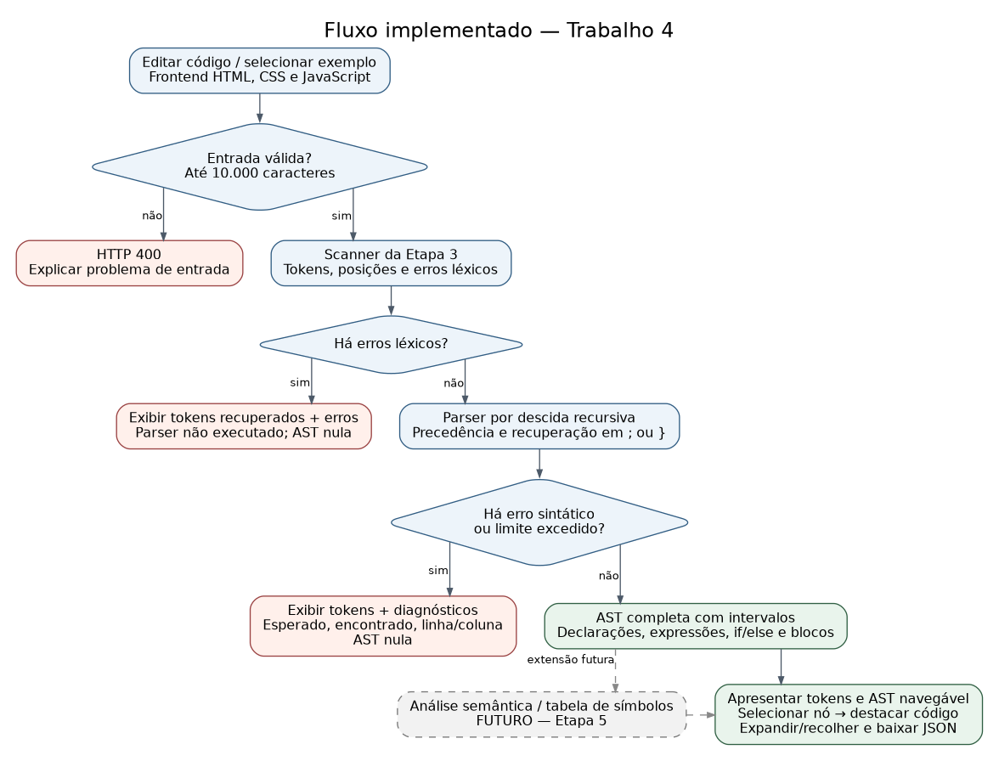

**Disciplina:** Compiladores  
**Professor:** Bruno Rocha  
**Estado desta versão:** resultados funcionais observados; avaliação com colegas ainda não aplicada. Documento preparado para a coleta, com lacunas de resultados humanos explicitadas. A conclusão da Tarefa 5 requer aplicar o instrumento e incorporar os dados reais.

# Resumo

Este trabalho apresenta a estratégia de implementação e o protocolo de avaliação de um software educacional para explorar análises léxica e sintática de Mini-C. A versão examinada integra tokens com posições, árvore sintática abstrata (AST) navegável, seleção de trechos do fonte e diagnósticos separados por fase. A comparação conserva nove estudos e inclui o próprio projeto, com classificação baseada em evidências e sem inferir ausências a partir de informações não encontradas. Dois novos artigos de avaliação fundamentam a combinação de tarefas padronizadas, questões objetivas específicas, itens de percepção e comentários abertos. A validação técnica reexecuta casos funcionais previamente definidos; o estudo com colegas está planejado, sem respostas humanas disponíveis nesta versão. Propõe-se uma atividade de explicação em duplas, com alternância de papéis, para investigar a exploração compartilhada das representações. A implementação permanece de uso individual; colaboração multiusuário, melhora de aprendizagem e exclusividade técnica não são resultados demonstrados. O documento distingue funcionamento observado, percepções a coletar e interpretações futuras, descrevendo limitações e condições de adaptação ao SBSC 2027.

**Palavras-chave:** ensino de compiladores; Mini-C; AST; avaliação formativa; avaliação por pares.

# 1. Introdução e contribuição investigada

O estudo de compiladores exige relacionar linguagem-fonte, reconhecimento de unidades e estruturas sintáticas. O projeto Mini-C organiza exemplos editáveis, tokens localizados, uma AST simplificada e diagnósticos em português para apoiar essa relação. A versão implementada até o Trabalho 4 utiliza um recorte explícito da linguagem, permitindo observar alterações no agrupamento de expressões e localizar construções no código.

A contribuição proposta é **organizar e avaliar uma experiência de exploração integrada de fonte, tokens, AST e diagnósticos para tarefas de interpretação de expressões e classificação de erros**. Para investigar seu uso em um contexto de Sistemas Colaborativos, planeja-se uma atividade de explicação em duplas. A prática colaborativa é um desenho de uso a aplicar, e não um recurso multiusuário já implementado no software.

Não se atribui ineditismo isolado à interface web, às explicações ou ao realce do fonte. Borela et al. (2025) já relacionam tokens/nós ao código, e Graciano Junior et al. (2022) apresentam visualizações, explicações e controles. A combinação pretendida precisa ser avaliada no contexto do projeto; os dados disponíveis não comprovam exclusividade nem superioridade sobre essas ferramentas.

A pergunta principal de avaliação é: **ao explorar a AST vinculada ao fonte, os participantes conseguem interpretar o agrupamento de expressões e distinguir erros das fases léxica e sintática, e como percebem o apoio dessa interação?** No uso em dupla, examina-se adicionalmente como a representação é utilizada na explicação entre colegas. Opinião favorável e acerto em uma tarefa serão tratados como evidências de naturezas distintas.

# 2. Trabalhos relacionados e comparação com o projeto

## 2.1. Base de comparação e critérios

Mantêm-se os nove estudos examinados na Tarefa 4. LISA e VCOCO apoiam a especificação e a visualização de compiladores (Mernik; Žumer, 2003; Resler; Deaver, 1998). Graciano Junior et al. (2022) apresentam uma ferramenta web com análise léxica e sintática e controles de exploração. Borela et al. (2025) descrevem interface web, artefatos de diferentes fases e árvore denominada de derivação. VERTO enfatiza organização modular e síntese para a máquina César (Schneider et al., 2005), enquanto Jabri (2013) investiga construção genérica de analisadores por gramáticas e autômatos.

JFLAP aborda modelos formais e parsing, com investigação educacional (Rodger et al., 2009). Jeliot 3 concentra-se na visualização da execução Java (Moreno et al., 2004). Santini et al. (2022) são mantidos como estudo secundário de jogos, cujas funcionalidades não são somadas como se pertencessem a um software único.

A matriz acrescenta **Este trabalho — Mini-C**, auditado na base `7fcb5ca`. As 135 células dos nove estudos anteriores são preservadas, acrescidas de 15 próprias. A fonte e a localização de cada classificação constam da matriz de evidências CSV/JSON que acompanha esta entrega. As versões e os limites de leitura dos estudos anteriores permanecem os da Tarefa 4; não houve nova inspeção de versões posteriores de todas as ferramentas.

**Legenda:** ✓ = presença confirmada; ✗ = ausência documentada na versão analisada; NI = informação insuficiente, sem inferir ausência; N/A = não aplicável. Não há colunas extras de ano ou nome de software: a identificação é feita pela referência. Os dois artigos novos sobre avaliação serão sintetizados na seção metodológica, pois suas contribuições não devem ser forçadas a competir como ferramentas de compiladores.

### 2.1.1. Interface, entrada e estruturas

| Referência | Web | Fonte | Exemp. | Léx. | Sint. | AST | Deriv. |
|---|---|---|---|---|---|---|---|
| Graciano Junior et al. (2022) | ✓ | ✓ | NI | ✓ | ✓ | NI | ✓ |
| Borela et al. (2025) | ✓ | ✓ | ✓ | ✓ | ✓ | NI | ✓ |
| Santini et al. (2022) | N/A | N/A | N/A | N/A | N/A | N/A | N/A |
| Mernik e Žumer (2003) | NI | ✓ | ✓ | ✓ | ✓ | NI | ✓ |
| Resler e Deaver (1998) | NI | ✓ | NI | ✓ | ✓ | NI | NI |
| Rodger et al. (2009) | NI | N/A | ✓ | NI | ✓ | NI | ✓ |
| Moreno et al. (2004) | NI | ✓ | NI | NI | NI | NI | NI |
| Schneider et al. (2005) | NI | ✓ | NI | ✓ | ✓ | NI | NI |
| Jabri (2013) | NI | N/A | NI | ✓ | ✓ | NI | NI |
| **Este trabalho — Mini-C (estado implementado)** | ✓ | ✓ | ✓ | ✓ | ✓ | ✓ | ✗ |

### 2.1.2. Processamento e apoio didático

| Referência | Semânt. | Símb. | Geração | Passos | Diag. | Explic. |
|---|---|---|---|---|---|---|
| Graciano Junior et al. (2022) | ✗ | NI | ✗ | ✓ | ✓ | ✓ |
| Borela et al. (2025) | ✓ | ✓ | ✓ | ✗ | NI | ✓ |
| Santini et al. (2022) | N/A | N/A | N/A | N/A | N/A | N/A |
| Mernik e Žumer (2003) | ✓ | NI | ✓ | ✓ | ✓ | NI |
| Resler e Deaver (1998) | NI | NI | NI | ✓ | NI | NI |
| Rodger et al. (2009) | NI | NI | NI | ✓ | NI | ✓ |
| Moreno et al. (2004) | NI | NI | NI | ✓ | ✓ | ✓ |
| Schneider et al. (2005) | ✓ | ✓ | ✓ | NI | NI | ✓ |
| Jabri (2013) | NI | NI | NI | NI | ✓ | NI |
| **Este trabalho — Mini-C (estado implementado)** | ✗ | ✗ | ✗ | ✗ | ✓ | ✓ |

### 2.1.3. Evidências de avaliação

| Referência | Estudantes | Aprendizagem |
|---|---|---|
| Graciano Junior et al. (2022) | ✓ | NI |
| Borela et al. (2025) | ✓ | NI |
| Santini et al. (2022) | N/A | N/A |
| Mernik e Žumer (2003) | ✓ | ✓ |
| Resler e Deaver (1998) | NI | NI |
| Rodger et al. (2009) | ✓ | ✓ |
| Moreno et al. (2004) | ✗ | ✗ |
| Schneider et al. (2005) | NI | NI |
| Jabri (2013) | ✓ | ✓ |
| **Este trabalho — Mini-C (estado implementado)** | ✗ | ✗ |

## 2.2. Interpretação da matriz e diferencial

“Fonte” na primeira tabela corresponde ao critério Entrada: edição de programa-alvo; “Exemplos”, materiais experimentáveis na ferramenta; “Passos”, acompanhamento controlado ou animado das transformações do algoritmo, e não somente navegação por resultados prontos. “Símb.” designa tabela de símbolos com identificadores e atributos. Árvore de derivação e AST são representações distintas e não recebem automaticamente a mesma marcação.

A coluna “Estudantes” exige aplicação real com participantes; “Aprendizagem” considera evidências pertinentes de conhecimento/desempenho, cujos desenhos e limites devem ser examinados. No estado atual do Mini-C, essas duas colunas são negativas porque a coleta humana ainda não ocorreu. Os testes automatizados não substituem essa avaliação. Uma apresentação ao professor também não constitui o estudo planejado.

A linha própria confirma web, editor, exemplos, scanner, parser, AST, diagnósticos e explicações. Estão ausentes árvore de derivação, semântica, tabela de símbolos, geração de código e animação dos passos do algoritmo. Algumas ausências são escolhas de escopo; não indicam que adicionar todas as funcionalidades seja necessário ao objetivo de estudo. A matriz não será convertida em um ranking por quantidade de marcas.

A ausência de AST confirmada em alguns textos (NI) não prova que as ferramentas não a ofereçam. Para afirmar exclusividade de uma combinação seria necessário delimitar versões, verificar recursos equivalentes e confirmar as ausências relevantes. Por isso, o diferencial defendido aqui é a proposta didática e sua investigação operacional. O estudo planejado examina tarefas concretas: interpretar precedência, relacionar nó e fonte e distinguir fases de diagnóstico.

# 3. Estratégia de implementação

A implementação é incremental e preserva a base anterior. O nginx fornece a interface HTML/CSS/JavaScript e encaminha requisições ao backend Python/FastAPI. A entrada é validada antes do scanner manual. Os tokens produzidos na Etapa 3 alimentam o parser descendente recursivo, sem reimplementação do reconhecimento léxico. Os módulos, a gramática EBNF, o contrato da API e os testes estão versionados no repositório.

O recorte sintático compreende declaração de uma variável `int` ou `float`, inicialização opcional, atribuição, expressões aritméticas/relacionais, sinais unários, blocos e `if/else` com chaves obrigatórias. Funções, laços, vetores, strings e operadores lógicos ficam fora desta versão. Relações, igualdade, soma, multiplicação e unários têm níveis de precedência definidos; operadores binários associam à esquerda. Um programa exige ao menos um item; `{}` é válido e comentários sozinhos não constituem programa.

O parser constrói nove tipos de nó: Programa, Declaracao, Atribuicao, Bloco, Se, Binario, Unario, Identificador e Literal. Todos têm início inclusivo e fim exclusivo, com linha e coluna a partir de 1. CRLF/CR são normalizados para LF, tab conta uma coluna e Unicode por ponto de código. Literais preservam seus lexemas. A AST omite pontuação e produções intermediárias; não é uma árvore de derivação.

A interface apresenta os nós com controles nativos de expansão/recolhimento, explicações por tipo de construção, seleção do trecho correspondente e exportação JSON. Os recursos percorrem uma AST pronta. O estado sintático é acrescentado à API sem mudar o significado dos campos léxicos existentes. Erros léxicos impedem chamar o parser. Em erro sintático, retorna-se AST nula e diagnósticos com esperado, encontrado e posição. A recuperação sincroniza em `;` ou `}`, podendo descartar construções e não garantindo a enumeração de todos os erros.

Os limites operacionais são 10.000 caracteres, 64 níveis estruturais ativos, 2.000 nós construídos e altura 128 da AST. Esses valores são decisões de engenharia, não resultados de experimento educacional. A reprodução usa Docker Compose, com backend e frontend separados. Na nuvem, a porta externa 18000 evita portas reservadas da plataforma; o padrão local é 8000 e a interface permanece em 8501.

{width=90%}

As próximas verificações semânticas deverão ter políticas de declaração, escopo e tipos definidas antes de sua implementação e avaliação. A presente tarefa teórica não apresenta o Trabalho 5 prático como concluído nem incorpora requisitos ainda não recebidos desse trabalho.

# 4. Fundamentação e escolha do método de avaliação

## 4.1. Pontes et al. (2019): avaliação comparativa e alinhamento de medidas

O artigo **Avaliação de Ferramentas para Ensino de Programação para Crianças e Adolescentes**, de Pontes et al. (2019), compara Scratch e Stencyl em um estudo de caso com 50 alunos do 8º e 9º anos, distribuídos em duas turmas de 25. A seção 2 (p. 746–747) organiza o estudo em objetivos, unidades de análise, unidades instrucionais, operação, análise/interpretação e documentação. As instruções e o tempo são planejados para reduzir diferenças entre as condições.

As medições ocorrem em quatro momentos, ao longo de quatro meses, com questões selecionadas do Bebras e nivelamento inicial pelo Code.org (p. 747–750). Os autores relatam evolução das turmas e indícios de que objetivos foram alcançados mais rapidamente com Scratch. O contexto, a diferença inicial entre os grupos e o detalhamento limitado da alocação impedem transportar essa conclusão para Mini-C. A seção 4 (p. 749) discute validade de construção, interna e externa, incluindo escolhas das questões e influência de instrutores/unidades de ensino.

Para este projeto, aproveita-se o encadeamento **objetivo → tarefa → resposta de referência → análise**, com instruções iguais e registro de ajuda. A adaptação consiste em perguntas sobre agrupamento da AST e diagnóstico, específicas da gramática examinada. Não se transfere o Bebras infantil para Compiladores nem se afirma replicar o estudo longitudinal. O artigo fundamenta planejamento e cautela interpretativa; não valida automaticamente o instrumento próprio desta tarefa.

**Referência e acesso:** Pontes et al. (2019), p. 744–752, DOI [10.5753/cbie.wie.2019.744](https://doi.org/10.5753/cbie.wie.2019.744). Texto integral no Anexo A da versão acadêmica com artigos.

## 4.2. Veras et al. (2020): usabilidade percebida e retorno para melhorias

O artigo **Desenvolvimento e Avaliação da Usabilidade em Aplicativo Desktop para o Ensino da Programação Orientada a Objetos**, de Veras et al. (2020), examina o JAvatar, um jogo desktop de perguntas sobre POO. Os autores relatam 20 estudantes de Sistemas de Informação. O método combina perfil, itens Likert de design/pedagogia, SUS e comentários/sugestões, relacionando problemas a revisões da interface.

As questões específicas são descritas na página interna 5 (correspondente à p. 182 da faixa publicada); SUS nas páginas internas 6–7 (183–184); sugestões e mudanças nas páginas 7–8 (184–185). A seção de resultados informa SUS médio 78,25 (página interna 9/186). Esse número pertence ao JAvatar e não é resultado ou parâmetro de aprovação do Mini-C. O artigo amplia suas conclusões para aprendizagem a partir de respostas de usabilidade e análise estatística; essa extrapolação não será adotada aqui, pois satisfação e percepção não substituem medida de conhecimento.

A contribuição metodológica aproveitada é distinguir **interação**, **utilidade didática percebida** e **dificuldades/sugestões**, acrescentando perguntas específicas da experiência investigada. Itens sobre diversão ou hábitos de jogo não serão copiados para uma ferramenta de compiladores. O questionário Mini-C não se apresentará como SUS adaptada ou escala validada. As localizações acima indicam página interna e sua correspondência na faixa 178–187, pois nem todas as páginas do PDF mostram numeração impressa.

**Referência e acesso:** Veras et al. (2020), p. 178–187, DOI [10.5753/ctrle.2020.11395](https://doi.org/10.5753/ctrle.2020.11395). Texto integral no Anexo B da versão acadêmica com artigos.

## 4.3. Método escolhido e justificativa

Seleciona-se uma **avaliação formativa por tarefas padronizadas**, combinando (a) verificação funcional por oráculos prévios; (b) observação de uso; (c) quatro questões objetivas de interpretação/classificação; (d) seis itens Likert específicos; e (e) dois campos abertos. A fonte sobre comparação de ferramentas orienta a padronização das condições e a separação entre desempenho e satisfação; o estudo de usabilidade orienta a coleta de percepções e dificuldades, com limites na transferência dos resultados para aprendizagem.

Não será aplicada uma versão abreviada ou adaptada da SUS sob o nome de escala validada. Os seis itens deste projeto formam um instrumento próprio, sem escore SUS e sem alegação de validação psicométrica. A opção permite perguntar diretamente sobre a interação investigada e manter baixo o esforço de um estudo inicial. Uma futura adoção da SUS exigiria sua aplicação integral e o procedimento correto de pontuação, separados dos itens específicos.

Também não se aplicará o teste Bebras utilizado por Pontes et al. como medida de domínio de Compiladores. As quatro perguntas próprias são alinhadas a tarefas e saídas verificáveis da gramática Mini-C. Elas indicam realização de tarefas apoiada pela ferramenta, sem equivaler a instrumento validado de conhecimento ou a ganho de aprendizagem.

O protocolo não contém grupo de controle ou pré/pós-teste. Portanto, permitirá descrever funcionamento, respostas às tarefas, percepções e dificuldades no contexto observado. Não permitirá atribuir causalmente aprendizagem ao software, à AST ou ao trabalho em dupla.

# 5. Protocolo da avaliação por pares

## 5.1. Versão, participantes e aplicação

O protocolo desta tarefa é definido em 26/11/2026, após a implementação da Etapa 4 e antes da coleta com colegas. Não é apresentado como pré-registro independente do desenvolvimento. Os casos funcionais e três oráculos estruturais foram fixados em 18/11/2026 e conservados sem alteração dos esperados. O histórico do projeto e os arquivos desta entrega permitem distinguir esse planejamento da reexecução atual.

A amostragem será por conveniência, com meta de viabilidade de 4 a 6 duplas (8 a 12 estudantes adultos cursando ou que já cursaram Compiladores). A meta não é cálculo de poder nem requisito que autorize fabricar participantes. A quantidade efetiva e as perdas deverão ser informadas. Professores e outros perfis serão mantidos em estratos separados. Um piloto individual poderá identificar problemas do roteiro, mas seus dados não serão agregados como evidência de colaboração.

Antes da aplicação, o autor combinará com o professor as regras institucionais de participação e uso/publicação dos dados. A chamada do SBSC não constitui dispensa geral de procedimentos institucionais. A participação será autorizada antes de iniciar as tarefas; o campo C01 registra novamente a decisão no formulário. A coleta será voluntária, com informação sobre objetivo, duração aproximada (20–30 minutos no total), ausência de avaliação acadêmica individual e possibilidade de sair antes do envio. O formulário não solicitará nome, e-mail ou matrícula; o registro do facilitador será por sessão, sem identificação direta, áudio ou vídeo. Comentários serão revisados para remover identificadores antes de qualquer divulgação.

A versão do software e do instrumento será congelada para a rodada. Corrigir um problema relevante exige registrar data, motivo e quais sessões foram afetadas; resultados de versões diferentes não serão silenciosamente combinados. O facilitador fará uma introdução igual para todos, explicando controles com um exemplo neutro, sem revelar os gabaritos das tarefas.

## 5.2. Atividade e componente colaborativo proposto

O modo principal prevê duas pessoas no mesmo computador, alternando os papéis de quem opera a interface e de quem explica a estrutura. Na primeira expressão, uma pessoa seleciona nós e a outra explica o agrupamento; na expressão com parênteses, os papéis se invertem. O objetivo comum é produzir uma explicação coerente e localizar o trecho correspondente. A discussão ocorre presencialmente, não por funcionalidades de chat, edição compartilhada ou coordenação automática do software.

Gerosa et al. (2006, seção 3, p. 132–133) descrevem o Modelo 3C: comunicação, coordenação e cooperação como dimensões interdependentes da colaboração. Aqui, a adaptação operacional será observar explicações/negociação sobre o agrupamento (comunicação), alternância dos papéis por roteiro (coordenação) e construção de uma justificativa ou correção comum sobre o código/AST (cooperação). A fonte fundamenta essa decomposição, não uma escala educacional validada nem um efeito de aprendizagem. O objeto visual é fornecido pelo Mini-C; comunicação e gestão dos turnos serão externas à aplicação. A observação presencial não se torna anônima para o facilitador apenas porque o Forms não solicita nomes; seu registro será minimizado e apresentado somente de forma agregada.

O facilitador observará se houve alternância, referência conjunta a nós/trechos, pedido de justificativa e correção ou negociação de uma explicação. Registrará comportamento ocorrido, ajuda fornecida e dificuldades; não inferirá colaboração apenas porque duas pessoas estavam presentes. O formulário será respondido individualmente após a atividade, com a interface disponível e sem consulta ao gabarito. As respostas podem ser dependentes pela discussão em dupla; não serão tratadas como observações independentes em testes inferenciais.

| Tarefa | Ação solicitada | Evidência a observar |
|---|---|---|
| A1 | Analisar `int resultado = 10 + 5 * 2;`, identificar agrupamento e localizar o operando direito da expressão | Operador que organiza a expressão, explicação e correspondência nó–fonte; necessidade de ajuda |
| A2 | Alterar para `int resultado = (10 + 5) * 2;`, inverter papéis e explicar a mudança | Uso dos parênteses na justificativa e mudança da estrutura; referência conjunta à representação |
| A3 | Analisar `int x = ;` e explicar fase, localização e conteúdo esperado | Distinção entre token reconhecido e expressão incompleta; leitura do diagnóstico |
| A4 | Analisar `@ int x;` e comparar os estados das fases com A3 | Identificação do erro léxico e explicação do parser não executado |

As respostas de referência e a rubrica do facilitador são fornecidas em arquivo separado. Uma resposta correta sem justificativa não será automaticamente interpretada como compreensão conceitual aprofundada. Quando houver ajuda, ela será registrada, permitindo distinguir realização autônoma, realização com ajuda e tarefa não concluída.

## 5.3. Instrumento e pergunta específica da contribuição

O formulário contém consentimento, perfil amplo, modo de aplicação, quatro questões objetivas (Q01–Q04), seis itens de percepção (L01–L06) e campos abertos para dificuldade e sugestão. A escala será: 1 discordo totalmente; 2 discordo; 3 nem concordo nem discordo; 4 concordo; 5 concordo totalmente; e **Não utilizei/não consigo avaliar**, fora da escala.

A pergunta diretamente associada à contribuição proposta é **L02: “A ligação entre AST interativa e trecho do código ajudou-me a explicar por que os parênteses mudam o agrupamento da expressão.”** A resposta verifica apoio percebido; Q01 e Q02, e a observação de A1/A2, verificam respostas e ações relacionadas. Essa triangulação evita usar somente uma opinião para afirmar que a interação cumpriu seu papel.

| Item | Aspecto investigado |
|---|---|
| L01 | Localizar no fonte a construção selecionada na AST |
| L02 | Apoio percebido para explicar o efeito dos parênteses no agrupamento |
| L03 | Distinção das fases de erro léxico e sintático |
| L04 | Clareza de rótulos/regras associados às construções |
| L05 | Apoio percebido da discussão com o colega à explicação; não aplicável no piloto individual |
| L06 | Facilidade geral de realização das tarefas |

O pacote inclui o texto exato para Google Forms e um Apps Script para criar um formulário **fechado para respostas até revisão** na conta do autor. O script não foi executado em uma conta Google nesta sessão; não existe link de formulário publicado nesta entrega. A criação/revisão e a aplicação são etapas do autor. O roteiro orienta conferir ausência de coleta de e-mails, restrição institucional e identificação nas perguntas antes de disponibilizar o link aos colegas.

## 5.4. Plano de análise

**Fatos observados:** número de casos funcionais executados/aprovados, respostas de Q01–Q04 conforme gabarito, tarefas concluídas e registros de ajuda/comportamento. **Percepções relatadas:** frequências e medianas dos itens Likert e comentários. **Interpretações:** relação cautelosa entre esses dados e os objetivos do projeto, sem generalização causal.

Para cada questão objetiva, relatar-se-ão número de respostas válidas e taxa de acerto, por modo e perfil. O total de formulários não será automaticamente chamado de número de participantes únicos: o anonimato impede verificar plenamente duplicações. Respostas sem consentimento serão excluídas; casos incompletos terão denominadores informados. No Forms, perguntas obrigatórias e alternativas explícitas reduzem ambiguidades, sem substituir a descrição de perdas.

Para cada item Likert, apresentar-se-ão frequências em 1–5, mediana, número de respostas válidas e não aplicáveis. Não aplicáveis serão informados e excluídos somente do denominador daquele item. Não haverá soma arbitrária de itens em um escore de aprendizagem ou de usabilidade validada. O item de dupla será analisado apenas nas sessões em dupla.

Campos abertos serão lidos e agrupados por tema, distinguindo relato de problema, sugestão e opinião. Não se fabricarão citações ilustrativas. A ferramenta de análise entregue ignora o conteúdo textual na saída agregada, reduzindo exposição acidental; o exame qualitativo e a remoção de identificadores exigem leitura humana. Os achados da observação por sessão serão apresentados separadamente dos formulários individuais, pois não há identificação pessoal para ligar as bases.

O analisador de CSV recebe a exportação do Forms, valida os campos e produz contagens por item, modo e perfil. Uma planilha vazia gera estado **sem respostas elegíveis**, sem médias, medianas ou porcentagens fictícias. Os testes do analisador usam apenas entradas sintéticas explicitamente identificadas como testes de código; elas não integram os resultados do estudo.

# 6. Resultados técnicos observados e dados humanos pendentes

## 6.1. Testes funcionais estruturados

A revalidação foi executada em 26/11/2026 sobre o commit `7fcb5ca` (hash completo nos metadados), em Linux/Docker. As imagens já existentes foram conferidas por hashes dos módulos e arquivos relevantes. Houve reuso do build; não se apresenta a execução como um novo build sem cache. O registro da Etapa 4, de outra data, permanece preservado.

| Verificação | Resultado nesta rodada | Interpretação |
|---|---|---|
| Backend: scanner, parser, API e validação | 229 aprovados; 0 falhas | Suíte técnica e regressão |
| Interface: lógica e DOM em Node/jsdom | 41 aprovados; 0 falhas | Comportamento e apresentação em ambiente de teste |
| Integração nginx → API → analisadores | Fluxo aprovado | Comunicação real entre serviços |
| Chromium real, desktop e viewport móvel | 60 cenários aprovados; 0 falhas | Navegação e consistência, sem participantes humanos |
| Casos congelados via API real nginx | 33 aprovados em 33 | Aprovação no conjunto previamente especificado |

Os 33 casos já integram a suíte de backend. Sua repetição pela API real é evidência adicional do mesmo conjunto; não se somam 33 novos cenários independentes para inflar uma contagem. Os cenários de navegador e os testes unitários também têm unidades de análise diferentes e são relatados separadamente.

O protocolo de casos contém 12 programas válidos, 3 casos léxicos inválidos, 10 sintáticos inválidos e 8 de borda. Todos os 33 foram executados. Cobertura de execução dos casos aplicáveis = 33/33 = 100%; aprovação = 33/33 executados = 100%; prontidão no conjunto aplicável = 33/33 planejados = 100%. **Cobertura de linhas/ramos de código não foi medida**; os percentuais não provam correção para todo programa possível.

Na distribuição observada, 14 entradas produziram sucesso sintático, 12 produziram erro sintático esperado, 4 bloquearam o parser por erro léxico e 3 foram rejeitadas por validação com HTTP 400. Rejeitar corretamente uma entrada inválida é aprovação do caso de teste. Os resultados individuais, diagnósticos, fontes e esperados estão em CSV/JSON no pacote; uma seleção é mostrada a seguir.

| Caso | Entrada/construção | Observado | Resultado |
|---|---|---|---|
| V01 | `int x;` | HTTP 200; sucesso | Aprovado |
| V04 | `int x = 1 + 2 * 3;` | HTTP 200; sucesso | Aprovado |
| V05 | `int x = (1 + 2) * 3;` | HTTP 200; sucesso | Aprovado |
| V06 | `int x = 8 - 3 - 1;` | HTTP 200; sucesso | Aprovado |
| V09 | `int x; if (x != 0) { x = 1; } else { x = 2; }` | HTTP 200; sucesso | Aprovado |
| L01 | `@ int x;` | HTTP 200; não executada | Aprovado |
| S01 | `int x` | HTTP 200; erro | Aprovado |
| S02 | `if (x > 0 { x = 1; }` | HTTP 200; erro | Aprovado |
| S04 | `int x = ;` | HTTP 200; erro | Aprovado |
| S06 | `int x = 1 + * 2;` | HTTP 200; erro | Aprovado |
| B01 | String vazia | HTTP 400;  | Aprovado |
| B04 | 10.000 caracteres, declaração ao final | HTTP 200; sucesso | Aprovado |
| B05 | 10.001 caracteres | HTTP 400;  | Aprovado |
| B06 | 64 blocos aninhados | HTTP 200; sucesso | Aprovado |
| B07 | 65 blocos aninhados | HTTP 200; erro | Aprovado |
| B08 | `@ int x; x = 1;` | HTTP 200; não executada | Aprovado |

As referências independentes V04–V06 verificam, respectivamente, soma com multiplicação à direita, mudança pelo agrupamento e associação à esquerda. Foram fixadas antes do parser; posições são verificadas separadamente. As suítes também exercitam seleção, expansão, download JSON, recuperação, EOF, compatibilidade do scanner e limites estruturais. O teste de viewport móvel simula 390 pixels; não constitui experiência com aparelho físico nem avaliação de acessibilidade completa.

M01–M03 (`x = 1;`, `int x; int x;`, `int x; x = 2.5;`) foram aceitos somente como controles de estrutura sintática. Sua avaliação semântica permanece **0/3 executada e 3 pendentes**, pois declaração, redeclaração e política de tipos ainda não foram implementadas. Esses casos não entram no denominador de 33 aplicáveis à versão atual. O plano completo continua explicitando 36 casos, sem esconder os três futuros.

## 6.2. Avaliação por pares: situação desta versão

**A avaliação com colegas ainda será aplicada**, conforme informação do autor. Não há formulários respondidos, observações de duplas, medianas Likert, taxas de acerto de pessoas ou comentários humanos a analisar. A ausência de coleta não é resultado negativo sobre usabilidade e não autoriza inventar opiniões, participantes ou escores.

O formulário, os roteiros, o consentimento, os gabaritos e o analisador estão preparados para a coleta. A conclusão da Tarefa 5 exige disponibilizar o formulário revisado, realizar as sessões e exportar as respostas. Após isso, esta seção deverá informar convites (quando conhecidos), sessões, respostas elegíveis, exclusões, resultados por item, ajuda observada e temas dos comentários. Os campos pendentes serão preenchidos somente com observações reais; nenhuma avaliação foi feita em nome de colegas.

## 6.3. Fatos, percepções e interpretação nesta rodada

**Fato observado:** a versão passou nos testes e casos descritos, com diagnósticos e AST compatíveis com os esperados do conjunto verificado. O pytest apresentou um aviso de depreciação da integração Starlette/AnyIO, sem reprovação. O funcionamento técnico está documentado em logs, metadados e capturas.

**Percepção relatada:** nenhuma, porque a coleta humana ainda não ocorreu. Os itens de compreensão, facilidade e discussão continuam como medidas planejadas.

**Interpretação fundamentada:** há evidência de viabilidade funcional para realizar as atividades propostas. A clareza para estudantes, o papel da discussão em dupla e a utilidade didática percebida ainda são questões abertas. A validação técnica não comprova aprendizagem nem exclusividade do projeto.

# 7. Limitações e ameaças à validade

**Construção:** os itens objetivos e Likert são próprios e ainda não validados psicometricamente. Identificar o operador correto com a árvore disponível é realização apoiada, não domínio independente de Compiladores. A pergunta sobre a contribuição mede apoio percebido. Pontes et al. (2019) ajudam a explicitar o alinhamento e os riscos da seleção de questões; Veras et al. (2020) mostram a utilidade e o limite de respostas de percepção.

**Interna:** experiência prévia, ordem das tarefas, ajuda do facilitador, efeito da explicação do colega e familiaridade com exemplos podem influenciar as respostas. O facilitador é envolvido no projeto, o que pode gerar viés e desejabilidade social. A ausência de pré/pós-teste ou condição de comparação impede inferência causal. A alternância de papéis será padronizada e a ajuda registrada, sem prometer eliminar esses fatores.

**Externa:** amostra pequena e por conveniência, uma disciplina, um recorte da linguagem e poucos dispositivos limitam transferência. Resultados de um computador Linux/Docker ou viewport estreito não representam todas as máquinas ou aparelhos. O perfil amplo e o modo serão informados, sem misturar silenciosamente professores, estudantes e piloto individual.

**Conclusão:** poucos casos/pessoas, dependência entre membros da dupla, não respostas e impossibilidade de identificar duplicações no formulário anônimo limitam análises. Serão usados resumos descritivos com denominadores, sem testes inferenciais inadequados ou um escore global inventado. Categorizar comentários exige julgamento e revisão humana.

**Comparação bibliográfica:** NI não é ausência; as ferramentas têm escopos e versões diferentes. Uma linha própria com mais marcações não constitui prova de novidade ou ganho educacional. As classificações são rastreáveis, mas o levantamento não é uma revisão sistemática exaustiva nem inspeção de todas as versões recentes.

# 8. Relação com o SBSC 2027

A chamada oficial consultada em 26/11/2026 inclui o eixo “Sistemas Colaborativos na Educação e em Ambientes Virtuais”, com ênfase no fator humano e nas interações sociais. A atividade de explicação em duplas é um contexto proposto para investigar o uso das representações. O código atual é de uso individual; avaliação por colegas, isoladamente, não demonstra colaboração educacional, e nenhuma interação social foi observada nesta rodada.

A trilha **Desenho de Pesquisa** aceita propostas/andamento, com artigo resumido de até quatro páginas e Ficha de Pesquisa de até três. **Ideias Inovadoras e Resultados Emergentes** requer resultados preliminares e tem quatro a oito páginas; a própria chamada orienta trabalhos apenas planejados para Desenho. **Artigos de Pesquisa** requer resultados científicos e admite até doze páginas de texto, conforme as exclusões definidas na chamada. A escolha deverá ser discutida com o professor após concretizar a atividade e verificar quais evidências estarão disponíveis.

Nas trilhas citadas, o prazo informado é 15/12/2026; as páginas consultadas não informam fuso ou horário final. Há modelo SBC, avaliação duplamente anônima e declaração explícita de uso de IAG. A nota de enquadramento no pacote registra URLs, trechos e diferenças das trilhas; datas e regras devem ser reconferidas antes de uma submissão.

Esta versão identificada é uma **entrega da disciplina para coleta**, com anexos solicitados pelo professor. Não é apresentada como artigo pronto para submissão ao SBSC: serão necessários adequação da extensão, escolha de trilha, consolidação das evidências, anonimização do texto/artefatos e revisão de autoria/afiliação. Os PDFs dos artigos de fundamentação são anexos acadêmicos, não anexos automáticos de uma submissão ao evento. Não houve submissão nem promessa de publicação.

# 9. Continuidade e declaração de apoio de IA

A próxima ação é revisar o formulário na conta Google do autor, aplicá-lo a colegas voluntários conforme o protocolo e analisar os dados reais. O artigo será então atualizado com resultados humanos, problemas encontrados, eventuais correções e limites da interpretação. A matriz própria só poderá receber avaliação com estudantes como presença depois da aplicação; aprendizagem só será marcada mediante evidência pertinente ao critério, sem converter opinião em ganho cognitivo.

Foi utilizado **ChatGPT/Codex, da OpenAI**, como apoio na pesquisa/organização de fontes, preparação do texto e dos instrumentos, programação e execução de verificações técnicas. O uso não constitui autoria da ferramenta. As afirmações são vinculadas a fontes e artefatos auditáveis; a conferência final, decisões acadêmicas, coleta com pessoas e responsabilidade pelo trabalho cabem ao autor e ao professor/orientador. Não foram produzidos dados fictícios de participantes como resultados de pesquisa.

Repositório do projeto: <https://github.com/warner03/software-educacional-compiladores>. A base funcional auditada é `7fcb5ca`; os materiais desta etapa serão organizados em `docs/etapa5/`. O histórico anterior é preservado e o Trabalho 5 prático ainda aguarda seus requisitos específicos.

# Referências

BORELA, Erik Pablo Schaefer; OLIVEIRA, Alessandra Lima de; BRANCO NETO, Wilson Castello; SOUZA, Alexandre Perin de. Uma Ferramenta Educacional de Apoio ao Ensino de Compiladores. In: *Anais do XXXIII Workshop sobre Educação em Computação*. Porto Alegre: SBC, 2025. p. 171–181. DOI: [10.5753/wei.2025.7407](https://doi.org/10.5753/wei.2025.7407).

GEROSA, Marco Aurélio; RAPOSO, Alberto Barbosa; FUKS, Hugo; LUCENA, Carlos José Pereira de. Component-Based Groupware Development Based on the 3C Collaboration Model. In: *Anais do XX Simpósio Brasileiro de Engenharia de Software*. Porto Alegre: SBC, 2006. p. 129–144. DOI: [10.5753/sbes.2006.21209](https://doi.org/10.5753/sbes.2006.21209).

GRACIANO JUNIOR, Wagner; GROSSERT, Iara Tavares da Silva; BRANCO NETO, Wilson Castello; AVILA, Alex Junior. Ferramenta interativa para o ensino de compiladores. In: *Anais do II Simpósio Brasileiro de Educação em Computação*. Porto Alegre: SBC, 2022. p. 224–233. DOI: [10.5753/educomp.2022.19217](https://doi.org/10.5753/educomp.2022.19217).

JABRI, Riad. A Generic Tool for Teaching Compilers. *Computer and Information Science*, v. 6, n. 2, p. 134–150, 2013. DOI: [10.5539/cis.v6n2p134](https://doi.org/10.5539/cis.v6n2p134). Texto integral consultado na Tarefa 4.

MERNIK, Marjan; ŽUMER, Viljem. An educational tool for teaching compiler construction. *IEEE Transactions on Education*, v. 46, n. 1, p. 61–68, 2003. DOI: [10.1109/TE.2002.808277](https://doi.org/10.1109/TE.2002.808277). Versão de leitura: manuscrito de 22 páginas fornecido para conferência.

MORENO, Andrés; MYLLER, Niko; SUTINEN, Erkki; BEN-ARI, Mordechai. Visualizing Programs with Jeliot 3. In: *Proceedings of the Working Conference on Advanced Visual Interfaces — AVI ’04*. Gallipoli: ACM, 2004. p. 373–376. DOI: [10.1145/989863.989928](https://doi.org/10.1145/989863.989928). Texto integral consultado no anexo da Tarefa 3.

PONTES, Renata F.; SANTANA, Jaindson V.; PERKUSICH, Mirko B.; BARBOSA, Anderson F.; GOMES, Vitor H.; SIMÕES, Moisés; CAMELO, Carlos A. S. Avaliação de Ferramentas para Ensino de Programação para Crianças e Adolescentes. In: *Anais do XXV Workshop de Informática na Escola*. Porto Alegre: SBC, 2019. p. 744–752. DOI: [10.5753/cbie.wie.2019.744](https://doi.org/10.5753/cbie.wie.2019.744). Texto integral: Anexo A desta tarefa.

RESLER, R. Daniel; DEAVER, Dean M. VCOCO: a visualisation tool for teaching compilers. In: *Proceedings of the 6th Annual Conference on the Teaching of Computing and the 3rd Annual Conference on Integrating Technology into Computer Science Education — ITiCSE ’98*. Dublin: ACM, 1998. p. 199–202. DOI: [10.1145/282991.283123](https://doi.org/10.1145/282991.283123).

RODGER, Susan H.; WIEBE, Eric; LEE, Kyung Min; MORGAN, Chris; OMAR, Kareem; SU, Jonathan. Increasing engagement in automata theory with JFLAP. In: *Proceedings of the 40th ACM Technical Symposium on Computer Science Education — SIGCSE ’09*. Chattanooga: ACM, 2009. p. 403–407. DOI: [10.1145/1508865.1509011](https://doi.org/10.1145/1508865.1509011).

SANTINI, Larissa F. S. Luz; CAMPANO JUNIOR, Maurilio M.; FELINTO, Alan Salvany; AYLON, Linnyer B. Ruiz. Jogos no Ensino de Linguagens Formais e Autômatos: Um Mapeamento Sistemático. In: *Anais Estendidos do XXI Simpósio Brasileiro de Jogos e Entretenimento Digital*. Porto Alegre: SBC, 2022. p. 886–895. DOI: [10.5753/sbgames_estendido.2022.226064](https://doi.org/10.5753/sbgames_estendido.2022.226064).

SCHNEIDER, Carlos Sérgio; PASSERINO, Liliana Maria; OLIVEIRA, Ricardo Ferreira de. Compilador Educativo VERTO: ambiente para aprendizagem de compiladores. *RENOTE*, v. 3, n. 2, p. 1–10, 2005. DOI: [10.22456/1679-1916.13949](https://doi.org/10.22456/1679-1916.13949). Nota: o PDF assina Carlos Sérgio Schneider; o portal registra o primeiro autor como Carlos Scheider. Texto integral consultado na Tarefa 4.

SOCIEDADE BRASILEIRA DE COMPUTAÇÃO. *SBSC 2027: chamadas, Artigos de Pesquisa, Desenho de Pesquisa e Ideias Inovadoras e Resultados Emergentes*. Disponível em: <https://sbsc.sbc.org.br/2027/index.php/chamadas/> e páginas vinculadas. Acesso em: 26 nov. 2026.

VERAS, Williany Thalita A.; NOGUEIRA, José Elvis S. S.; SILVA, João Emerson N.; D’EMERY, Richarlyson A. Desenvolvimento e Avaliação da Usabilidade em Aplicativo Desktop para o Ensino da Programação Orientada a Objetos. In: *Anais do V Congresso sobre Tecnologias na Educação*. Porto Alegre: SBC, 2020. p. 178–187. DOI: [10.5753/ctrle.2020.11395](https://doi.org/10.5753/ctrle.2020.11395). Texto integral: Anexo B desta tarefa.
