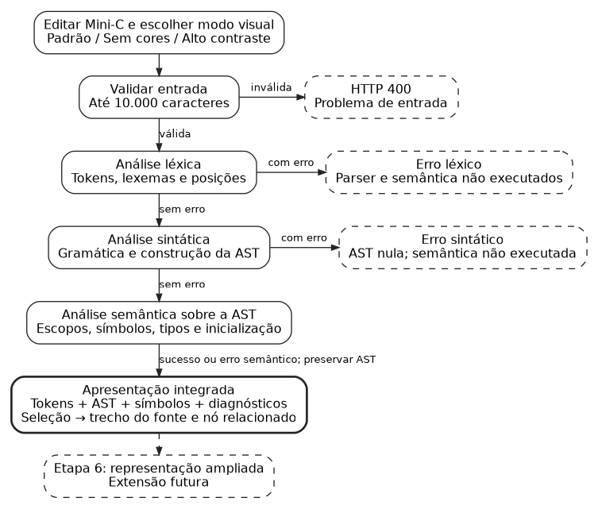

**Disciplina:** Compiladores  
**Professor:** Bruno Rocha  
**Versão:** atualizada após o Trabalho 5. Validação técnica concluída; avaliação com colegas ainda não aplicada.

# Resumo

Este trabalho apresenta a implementação e a estratégia de avaliação de um software educacional web para explorar as análises léxica, sintática e semântica de Mini-C. A ferramenta relaciona código-fonte, tokens, árvore sintática abstrata e tabela de símbolos, apresentando diagnósticos em português com localização, regra violada e sugestão de correção. Sua contribuição de projeto é integrar essa exploração a modos Sem cores, com padrões e rótulos, e Alto contraste, para reduzir a dependência de distinções cromáticas. A comparação inclui nove estudos anteriores e o próprio projeto, com evidências por classificação e dois critérios de acessibilidade visual. Dois artigos científicos fundamentam uma avaliação formativa com tarefas padronizadas e um formulário curto. Na validação técnica, passaram 322 testes de backend, 55 de interface, 134 cenários de navegador e 30 casos semânticos pela API real. As medidas de contraste dos elementos examinados atenderam aos limiares adotados. Não houve coleta com colegas ou pessoas daltônicas; a utilidade percebida e a contribuição educacional permanecem questões a investigar. Os resultados técnicos e o protocolo humano são apresentados separadamente, com limitações e considerações sobre o SBSC 2027.

**Palavras-chave:** ensino de compiladores; Mini-C; análise semântica; acessibilidade visual; avaliação formativa.

# Abstract

This paper presents a web-based educational tool for exploring lexical, syntactic and semantic analysis in Mini-C. Source code, tokens, an abstract syntax tree and a symbol table are connected through localized explanations and diagnostics. The design contribution combines this exploration with a color-independent mode using patterns and labels, and a high-contrast mode. Nine previous studies and the proposed tool are compared using evidence-based classifications. Two evaluation studies inform a formative protocol with standardized tasks and a short questionnaire. Technical validation passed 322 backend tests, 55 interface tests, 134 browser scenarios and 30 semantic API cases. Measured contrast ratios met the adopted thresholds. Peer evaluation and participation of colorblind users have not taken place; therefore, accessibility effectiveness and educational benefit are not claimed as demonstrated outcomes.

# 1. Introdução e objetivos

Aprender compiladores envolve relacionar unidades léxicas, organização sintática e regras de significado. Quando essas representações são apresentadas de forma isolada, o estudante precisa reconstruir mentalmente suas correspondências. O projeto organiza essa exploração em uma interface: selecionar um token, símbolo, referência ou diagnóstico permite localizar a construção no fonte, enquanto a AST apresenta a estrutura reconhecida.

A linguagem Mini-C foi escolhida por conservar construções familiares de C — declarações, expressões, blocos e condicionais — em um recorte que permite explicar integralmente as regras implementadas. Ela reduz a quantidade de recursos necessários à observação das fases iniciais. Não é uma implementação de C completo: as diferenças de tipos e condições são documentadas, sem atribuir ao estudante regras implícitas que a ferramenta não verifica.

O objetivo geral é apoiar a interpretação das fases de compilação sem exigir que a informação visual seja distinguida somente por cor. Os objetivos específicos são integrar as três análises, relacionar símbolos e diagnósticos ao fonte/AST, oferecer alternativas visuais e avaliar funcionamento, realização de tarefas e percepções de colegas.

O **diferencial implementado** é a combinação de **modos Sem cores e Alto contraste com a exploração interativa de tokens, AST, tabela de símbolos e erros explicados**. No modo Sem cores, padrões de sublinhado, textos e contornos permitem acompanhar categorias e seleção. A proposta responde à demanda de apoio a usuários daltônicos, mas sua eficácia com esse público ainda requer avaliação. A existência do recurso é verificável; sua exclusividade frente a todas as ferramentas não foi demonstrada.

A pergunta de avaliação é: **os participantes conseguem identificar os resultados das análises e localizar as construções sem depender das cores, e como percebem o apoio do modo Sem cores e da tabela de símbolos?** Essa pergunta combina uma tarefa verificável com percepção específica, sem transformar opinião em prova de aprendizagem.

# 2. Trabalhos relacionados e matriz comparativa

Os nove estudos das etapas anteriores foram mantidos. Graciano Junior et al. (2022) e Borela et al. (2025) apresentam ferramentas educacionais web; LISA e VCOCO apoiam construção e visualização de compiladores (Mernik; Žumer, 2003; Resler; Deaver, 1998). VERTO reúne etapas de compilação e síntese para a máquina César (Schneider et al., 2005), e Jabri (2013) descreve construção genérica de analisadores. Rodger et al. (2009) investigam JFLAP no ensino de autômatos, enquanto Moreno et al. (2004) apresentam visualização de execução com Jeliot 3. Santini et al. (2022) são um mapeamento de jogos, não uma ferramenta única.

A revisão preserva as 135 classificações dos nove estudos nos quinze critérios anteriores. A linha do Mini-C foi atualizada para o código do Trabalho 5, e dois critérios foram acrescentados a todas as linhas: modo Sem cores e modo Alto contraste. A matriz passa a conter dez linhas e dezessete critérios, totalizando 170 células com evidências em CSV/JSON. As versões de leitura dos estudos anteriores permanecem delimitadas na documentação; não se inspecionaram todas as versões atuais dos softwares.

**Legenda:** ✓ presença confirmada; ✗ ausência documentada na versão examinada; NI informação insuficiente; N/A não aplicável. A identificação é feita pela referência, sem colunas separadas de ano ou nome do software, conforme a orientação do professor. Os dois novos artigos de método são sintetizados na seção 4, pois não descrevem ferramentas concorrentes de compiladores.

## 2.1. Interface, entrada e estruturas

<!-- MATRIZ_1_INICIO -->
| Referência | Web | Entrada | Exemplos | Léxica | Sintática | AST | Derivação |
|---|---|---|---|---|---|---|---|
| Graciano Junior et al. (2022) | ✓ | ✓ | NI | ✓ | ✓ | NI | ✓ |
| Borela et al. (2025) | ✓ | ✓ | ✓ | ✓ | ✓ | NI | ✓ |
| Santini et al. (2022) | N/A | N/A | N/A | N/A | N/A | N/A | N/A |
| Mernik e Žumer (2003) | NI | ✓ | ✓ | ✓ | ✓ | NI | ✓ |
| Resler e Deaver (1998) | NI | ✓ | NI | ✓ | ✓ | NI | NI |
| Rodger et al. (2009) | NI | N/A | ✓ | NI | ✓ | NI | ✓ |
| Moreno et al. (2004) | NI | ✓ | NI | NI | NI | NI | NI |
| Schneider et al. (2005) | NI | ✓ | NI | ✓ | ✓ | NI | NI |
| Jabri (2013) | NI | N/A | NI | ✓ | ✓ | NI | NI |
| **Este trabalho — Mini-C** | ✓ | ✓ | ✓ | ✓ | ✓ | ✓ | ✗ |
<!-- MATRIZ_1_FIM -->

“Fonte” corresponde ao critério Entrada, edição de programa-alvo; “Exemp.” representa exemplos experimentáveis na ferramenta. AST simplificada e árvore de derivação são representações distintas: a menção a uma não confirma a outra.

## 2.2. Processamento e apoio didático

<!-- MATRIZ_2_INICIO -->
| Referência | Semânt. | Símb. | Geração | Passos | Diag. | Explic. |
|---|---|---|---|---|---|---|
| Graciano Junior et al. (2022) | ✗ | NI | ✗ | ✓ | ✓ | ✓ |
| Borela et al. (2025) | ✓ | ✓ | ✓ | ✗ | NI | ✓ |
| Santini et al. (2022) | N/A | N/A | N/A | N/A | N/A | N/A |
| Mernik e Žumer (2003) | ✓ | NI | ✓ | ✓ | ✓ | NI |
| Resler e Deaver (1998) | NI | NI | NI | ✓ | NI | NI |
| Rodger et al. (2009) | NI | NI | NI | ✓ | NI | ✓ |
| Moreno et al. (2004) | NI | NI | NI | ✓ | ✓ | ✓ |
| Schneider et al. (2005) | ✓ | ✓ | ✓ | NI | NI | ✓ |
| Jabri (2013) | NI | NI | NI | NI | ✓ | NI |
| **Este trabalho — Mini-C** | ✓ | ✓ | ✗ | ✗ | ✓ | ✓ |
<!-- MATRIZ_2_FIM -->

“Símb.” identifica tabela com nomes e atributos. “Passos” exige acompanhamento controlado ou animado das transformações do algoritmo. Navegar por tokens e uma árvore já produzidos não preenche esse critério. “Diag.” e “Explic.” representam diagnósticos e explicações didáticas documentados.

## 2.3. Acessibilidade visual e avaliação

<!-- MATRIZ_3_INICIO -->
| Referência | Sem cores | Alto contraste | Estudantes | Aprendizagem |
|---|---|---|---|---|
| Graciano Junior et al. (2022) | NI | NI | ✓ | NI |
| Borela et al. (2025) | NI | NI | ✓ | NI |
| Santini et al. (2022) | N/A | N/A | N/A | N/A |
| Mernik e Žumer (2003) | NI | NI | ✓ | ✓ |
| Resler e Deaver (1998) | NI | NI | NI | NI |
| Rodger et al. (2009) | NI | NI | ✓ | ✓ |
| Moreno et al. (2004) | NI | NI | ✗ | ✗ |
| Schneider et al. (2005) | NI | NI | NI | NI |
| Jabri (2013) | NI | NI | ✓ | ✓ |
| **Este trabalho — Mini-C** | ✓ | ✓ | ✗ | ✗ |
<!-- MATRIZ_3_FIM -->

“Sem cores” exige modo selecionável que diferencie os resultados por padrões/rótulos; “Alto contraste” exige modo visual alternativo explicitamente documentado. Esses critérios foram introduzidos a partir do requisito de acessibilidade, apoiado pelas orientações W3C sobre uso da cor e contraste (W3C, s.d.). Uma figura em preto e branco, realce colorido ou interface textual não comprova a existência dos modos.

A revisão dos textos integrais e dos registros de funcionalidades não confirmou esses dois modos nos oito estudos primários; por isso, as células são NI. O mapeamento de Santini et al. permanece N/A, sem reunir recursos de jogos distintos em um sistema imaginário. A auditoria complementar registra os documentos examinados e seus limites. NI não foi convertido em ausência para produzir um diferencial artificial.

“Estudantes” exige aplicação real com participantes; “Aprendizagem” exige evidência pertinente de conhecimento/desempenho, examinada conforme o desenho do estudo. O Mini-C ainda não tem esses resultados. Uma linha com vários ✓ não constitui ranking de qualidade, e não é necessário reproduzir todas as fases de um compilador para justificar o recorte educacional.

# 3. Materiais, implementação e acessibilidade

## 3.1. Arquitetura e recorte Mini-C

O frontend utiliza HTML, CSS e JavaScript, servido por nginx, e o backend utiliza Python/FastAPI. Docker Compose organiza a execução reproduzível. O scanner manual produz tokens com lexema e posição; o parser descendente recursivo aplica a gramática e constrói a AST; a análise semântica percorre essa árvore sem modificá-la. Scanner, parser, formato da AST e testes anteriores foram preservados.

O recorte aceita uma variável por declaração, tipos `int` e `float`, inicialização opcional, atribuição, aritmética, comparações, sinais unários, blocos e `if/else` com chaves. As posições começam em 1 e os intervalos têm fim exclusivo. A AST contém nove tipos de nó, omite pontuação e produções intermediárias e pode ser expandida, localizada no fonte e exportada em JSON.

{height=19cm}

Erro léxico bloqueia parser e semântica; erro sintático bloqueia a semântica e retorna AST nula. Um erro semântico preserva tokens, AST e as declarações reconhecidas, com o resultado explicitamente marcado como erro. A API acrescenta `semantica` sem mudar o significado léxico do campo superior `sucesso`, preservando compatibilidade. A interface apresenta o estado de cada fase por texto.

## 3.2. Estratégia semântica e tabela de símbolos

A estratégia é um percurso único da AST, coerente com a exigência de declaração antes do uso. Uma pilha de dicionários representa escopos ativos; a busca vai do mais interno ao global. Listas de símbolos e escopos preservam os resultados para apresentação após o fechamento dos blocos. Permite-se sombreamento em bloco interno, sem redeclaração no mesmo escopo.

A análise verifica declaração, visibilidade, redeclaração, compatibilidade de atribuição, operandos numéricos, comparações, condição e inicialização definida. Aceita tipos iguais ou promoção de `int` para `float`; rejeita a conversão inversa e a conversão de `bool` em número. Comparações produzem um tipo interno `bool`, sem acrescentar um tipo de variável à gramática. O `if` exige esse resultado; por exemplo, `if(x != 0)` é permitido e `if(x)` numérico é rejeitado. Essa política explícita difere de C completo.

Uma variável deve estar inicializada antes da leitura. Depois de `if/else`, só permanecem garantidas as inicializações presentes nos dois caminhos. Sem `else`, considera-se o caminho que não executa o bloco. Não há execução de condições constantes ou cálculo de valores. O atributo “inicializado” da tabela informa a garantia no fim do escopo que declarou o símbolo, não um valor de execução.

Cada símbolo possui identificador, nome, tipo, escopo, posição de declaração, garantia de inicialização, eventual símbolo sombreado e referências de leitura/atribuição. A interface filtra escopos e permite selecionar declarações, referências e erros. Os intervalos e caminhos de nós ligam essas ações ao código e à AST. Diagnósticos apresentam regra, mensagem acessível e sugestão; a propagação de tipo desconhecido reduz erros artificiais em cascata.

Funções, laços, arrays, ponteiros, conversões explícitas, divisão por zero, overflow, execução e geração de código estão fora do recorte. Os limites herdados são 10.000 caracteres, 64 níveis estruturais, 2.000 nós construídos e altura 128 da AST. São limites de engenharia, sem significado de eficácia educacional.

## 3.3. Recursos para reduzir a dependência de cores

A orientação W3C para uso da cor estabelece que ela não deve ser o único meio visual de comunicar informação. Os documentos de contraste orientam contraste mínimo de texto e elementos não textuais (W3C, s.d.). Esses princípios fundamentam os recursos escolhidos; a presença de um seletor visual, isoladamente, não demonstra conformidade integral.

| Recurso | Implementação verificável |
|---|---|
| Sem cores | Paleta acromática, padrões por categoria, legenda e rótulos textuais |
| Alto contraste | Paleta alternativa clara sobre fundo escuro, mantendo padrões e textos |
| Categorias de tokens | Sublinhados duplo, contínuo, pontilhado, tracejado e ondulado; delimitadores em negrito |
| Seleção e navegação | Contorno, indicação textual de posição e ligação do símbolo/erro ao fonte e à AST |
| Operação | Controles nativos, foco visível, navegação por teclado e preferência visual persistida quando permitida |

Trocar o modo não executa novamente a análise nem altera a entrada ou o resultado. Os estados de sucesso, erro e fase não executada permanecem escritos. A proposta não aplica filtro como suposta correção da visão: oferece informação redundante para que diferenças de matiz não sejam indispensáveis.

# 4. Fundamentação e escolha do método de avaliação

## 4.1. Pontes et al. (2019)

Em **Avaliação de Ferramentas para Ensino de Programação para Crianças e Adolescentes**, os autores comparam Scratch e Stencyl em um estudo de caso com 50 alunos do 8º e 9º anos, em duas turmas de 25. O método organiza objetivos, unidades de análise, unidades instrucionais, operação, análise/interpretação e documentação (p. 746–747). As quatro medições ao longo de quatro meses utilizam questões selecionadas do Bebras e nivelamento com Code.org (p. 747–750).

O estudo relata evolução das turmas e indícios de alcance mais rápido de objetivos com Scratch. A diferença inicial entre grupos e o detalhamento limitado da alocação impedem transportar esse resultado para Mini-C. A discussão de validade de construção, interna e externa explicita riscos na seleção das questões e na influência das condições de ensino (p. 749).

Adota-se desse artigo o alinhamento **objetivo → tarefa → resposta de referência → análise**, com entradas iguais e registro de ajuda. Não se aplica o Bebras como instrumento validado de Compiladores nem se apresenta a avaliação curta como réplica do estudo longitudinal. O texto integral é o Anexo A da versão acadêmica com artigos.

## 4.2. Veras et al. (2020)

Em **Desenvolvimento e Avaliação da Usabilidade em Aplicativo Desktop para o Ensino da Programação Orientada a Objetos**, os autores avaliam o JAvatar com 20 estudantes de Sistemas de Informação. Combinam perfil, itens Likert de design e aspectos pedagógicos, SUS e comentários, utilizando o retorno para revisar a interface. A descrição dos itens está na página interna 5 do PDF (p. 182 da faixa publicada); SUS nas páginas internas 6–7; sugestões e alterações nas páginas 7–8.

Os autores relatam SUS médio 78,25 na página interna 9 (p. 186). O valor pertence ao JAvatar e não constitui resultado nem nota de aprovação do Mini-C. Percepções positivas de usabilidade também não são, por si, medida de aprendizagem.

Adota-se a separação entre facilidade de interação, utilidade didática percebida e dificuldades/sugestões. Não são copiados itens de jogos, nem calculado SUS com questionário abreviado. O texto integral é o Anexo B. As referências completas e DOIs dos dois estudos constam ao fim deste artigo.

## 4.3. Método escolhido

O método é uma **avaliação formativa por tarefas padronizadas**, combinando testes funcionais, observação breve e seis perguntas próprias. A padronização é fundamentada em Pontes et al.; a coleta de percepções e sugestões, em Veras et al. Os objetivos do projeto determinam perguntas específicas sobre erros, acessibilidade visual e símbolos, evitando um formulário genérico.

O instrumento foi reduzido para duas questões objetivas, três afirmações em escala de concordância e uma questão aberta opcional. Esse formato atende ao pedido de simplicidade e mantém evidências de naturezas distintas. Não é SUS, avaliação heurística formal ou escala psicometricamente validada. Sem pré/pós-teste e grupo de comparação, não permite atribuir causalmente aprendizagem ou superioridade a qualquer modo visual.

# 5. Protocolo curto de avaliação com colegas

## 5.1. Participação e procedimento

O protocolo versão 3.0 foi definido após o Trabalho 5 e antes de qualquer coleta humana informada. A versão anterior foi preservada no histórico; seus itens e gabaritos não serão misturados aos atuais. A amostra será de conveniência, entre colegas adultos cursando ou que já cursaram Compiladores. Pretende-se convidar de 4 a 6 duplas, se viável; será informado o número efetivo, sem tratar a meta como resultado.

Cada sessão utilizará a mesma versão do software, entradas e instruções, com cerca de 10–15 minutos de atividade e aproximadamente três minutos para o formulário. Em dupla, as pessoas alternam entre operar a interface e explicar o resultado. Um piloto individual poderá verificar o roteiro e será analisado separadamente.

Antes das tarefas, o facilitador explica o objetivo, a participação voluntária e as condições de uso dos dados, conforme orientações do professor e da instituição. O formulário solicita aceite, modo de uso e as seis perguntas, sem nome, e-mail, matrícula ou condição de saúde. Não haverá áudio/vídeo. A observação presencial é conhecida pelos envolvidos; as anotações serão por sessão, sem ligação individual ao formulário.

| Atividade | Ação e registro |
|---|---|
| A1 — símbolos e fonte | Analisar `int x = 1; float y = x + 2.5;`. Localizar a declaração e a referência de `x`, observando fonte e AST. Registrar conclusão e ajuda. |
| A2 — significado | Analisar `int x = 1; total = x + 2;`. Identificar fase, regra e trecho do erro; alternar quem opera e quem explica. |
| A3 — informação sem cor | Escolher Sem cores e analisar `int x = ;`; identificar a fase pelos rótulos. Depois testar `@ int x;`, comparar os estados e experimentar Alto contraste. |

O facilitador usa um exemplo neutro para explicar os controles, sem revelar respostas. O gabarito fica separado do guia dos colegas. Para cada atividade, anota conclusão sem ajuda, com ajuda ou não conclusão. O formulário é respondido individualmente, com a interface disponível e sem acesso ao gabarito.

## 5.2. Seis perguntas e questão do diferencial

As duas questões objetivas oferecem alternativas léxico, sintático, semântico e “não sei”, ajustadas ao enunciado. Para as afirmações, a escala é 1 discordo totalmente, 2 discordo, 3 nem concordo nem discordo, 4 concordo e 5 concordo totalmente, com **N/A — não usei ou não consigo avaliar** fora da escala.

| Código | Pergunta exata | Tipo |
|---|---|---|
| Q01 | Em `int x = 1; total = x + 2;`, qual erro o software indicou? | Múltipla escolha |
| Q02 | No modo Sem cores, em `int x = ;`, qual fase indicou o erro? | Múltipla escolha |
| L01 | Foi fácil usar o software. | Concordância 1–5 ou N/A |
| L02 | No modo Sem cores, consegui identificar os resultados sem depender das cores. | Concordância 1–5 ou N/A |
| L03 | A tabela de símbolos ajudou a entender onde as variáveis foram declaradas. | Concordância 1–5 ou N/A |
| A01 | O que você melhoraria no software? | Aberta, opcional |

**L02 é a pergunta diretamente relacionada ao diferencial.** Ela mede percepção de identificação sem dependência de cores. Q02 e a observação de A3 verificam uma tarefa realizada nesse modo; L03 e A1 examinam o apoio dos símbolos. A combinação permite comparar relatos com ações, sem concluir que um acerto demonstra aprendizagem ou que respondentes em geral representam pessoas daltônicas.

O conteúdo completo está pronto para copiar no Google Forms. Há também um gerador opcional de rascunho, fechado para respostas até revisão. Ele não foi executado em conta Google nesta entrega: nenhum link de formulário foi criado, publicado ou enviado a colegas.

## 5.3. Análise e contexto colaborativo

Serão apresentados, por modo individual/dupla, os números de respostas elegíveis, perdas e não respostas. Para Q01/Q02, serão informados acertos e denominadores; “não sei” é resposta válida não correta. Para cada afirmação, serão apresentadas frequências em 1–5, mediana e quantidade de N/A, excluída somente do denominador daquele item. Não haverá soma em uma nota global de aprendizagem ou escore SUS.

As sugestões serão agrupadas por tema após leitura e retirada de identificadores. A análise automática não reproduz os textos livres. Sem respostas, as estatísticas permanecem nulas. Dados sintéticos usados para testar o analisador são rotulados e não entram nos resultados acadêmicos.

Para aproximar o projeto do contexto do SBSC, a atividade em dupla prevê comunicação por explicação/negociação, coordenação por alternância de papéis e cooperação na interpretação do mesmo código. Essa organização é inspirada no Modelo 3C (Gerosa et al., 2006, p. 132–133). O facilitador registra se os comportamentos ocorreram, sem inferir colaboração apenas pela presença de duas pessoas. Comunicação e turnos ocorrem presencialmente; o software não implementa chat ou edição multiusuário. As respostas de membros da mesma dupla podem ser dependentes e não serão tratadas como observações independentes em inferências estatísticas.

# 6. Resultados técnicos e situação da avaliação humana

## 6.1. Validação funcional da versão implementada

A rodada final ocorreu em 26/11/2026, entre 21h22 e 21h23, horário de São Paulo. Os arquivos testados ainda eram alterações locais sobre a base `0637b7d`; seus hashes foram registrados e posteriormente conferidos contra o commit de código `2b535d1`. A entrega prática foi integrada à `main` em `1de2b61`. Essa descrição preserva os metadados originais e não apresenta o commit posterior como existente no início dos testes.

| Verificação | Resultado observado | Evidência |
|---|---|---|
| Backend: scanner, parser, semântica e API | 322 aprovados; 0 falhas | Log pytest e testes versionados |
| Interface: lógica e DOM | 55 aprovados; 0 falhas | Log Node/jsdom |
| Integração nginx/API | Fluxo aprovado | Smoke test dos três resultados e bloqueios |
| Chromium real | 134 cenários aprovados; 0 falhas | Desktop e viewport de 390 pixels |
| Casos semânticos pela API | 30/30 aprovados | CSV/JSON com esperados e observados |
| Reconstrução Docker sem cache | Concluída | Log do build preservado |

Os trinta casos semânticos foram fixados antes do analisador, com onze programas válidos e dezenove com violações esperadas. Os esperados não foram gerados pelo código avaliado. Eles já pertencem à suíte de backend: sua execução HTTP é evidência adicional de integração, sem somá-los como trinta testes independentes. Testes, cenários e casos têm unidades diferentes e permanecem em linhas separadas.

No conjunto externo, cobertura de execução = 30/30 = 100% dos casos planejados; aprovação = 30/30 = 100% dos executados. Esses valores não representam cobertura de linhas/ramos, que não foi medida, nem correção para toda entrada Mini-C. Rejeitar corretamente um programa inválido é aprovação do teste.

| Caso | Entrada/construção | Esperado e observado |
|---|---|---|
| M01 | `x = 1;` | Identificador não declarado |
| M02 | `int x; int x;` | Redeclaração no mesmo escopo |
| M03 | `int x; x = 2.5;` | Incompatibilidade de tipos |
| A01 | `int x = 1; float y = x + 2.5;` | Sucesso, com promoção numérica |
| A06 | `x` global e `x` float em bloco interno | Sucesso; sombreamento e referências separados |
| A09 | `x` atribuído nos dois ramos antes da leitura | Sucesso; inicialização garantida |
| A10 | `x` atribuído só no ramo if antes da leitura | Variável não inicializada |
| A12 | `int x=1; if(x){x=2;}` | Condição não booleana |
| A20 | `z=y+1;` | Dois usos não declarados, sem erros artificiais de tipo |

M01–M03, antes pendentes, agora foram efetivamente avaliados semanticamente. Não foram aprovados por mera aceitação sintática. As regressões também verificam erros léxicos/sintáticos, precedência, posições, limites, seleção e preservação da AST. Scanner, parser e os onze arquivos anteriores de testes permaneceram idênticos à base.

## 6.2. Verificação técnica dos modos visuais

Foram examinadas três preferências visuais e quatro estados de análise em dois tamanhos de tela, totalizando 24 combinações de medidas textuais, além de seis verificações de foco/seleção. O procedimento usa luminância relativa sRGB e cores/fundos computados, incluindo gradientes. Controles desabilitados são excluídos. Adotaram-se limiares de 4,5:1 para o texto regular examinado e 3:1 para foco/contorno de seleção, com referência nos documentos W3C.

| Modo | Menor contraste de texto | Foco | Seleção |
|---|---|---|---|
| Padrão | 6,749:1 | 6,345:1 | 6,082:1 |
| Sem cores | 8,934:1 | 16,570:1 | 11,589:1 |
| Alto contraste | 16,275:1 | 13,584:1 | 4,217:1 |

Os valores são mínimos observados nos elementos medidos, não mínimos garantidos de qualquer conteúdo futuro da página. Os cenários também verificaram teclado, persistência, padrões, rótulos, seleção e troca de modo sem perder resultados. Foram produzidas capturas sob simulações de protanopia, deuteranopia, tritanopia e acromatopsia no Chromium. Tais inspeções não equivalem à experiência de pessoas daltônicas nem a auditoria WCAG integral.

## 6.3. Fatos, percepções e interpretação

**Fatos observados:** os testes descritos passaram; os modos visuais estão implementados; as medidas atenderam aos limiares nos elementos examinados. Os registros completos, hashes e capturas estão em `docs/trabalho5/`. O aviso de depreciação Starlette/AnyIO do pytest não correspondeu a falha funcional.

**Percepções relatadas:** ainda não existem respostas reais de colegas ou observações de sessões. Não há medianas de participantes, opiniões, taxas humanas de acerto ou resultados de colaboração a apresentar. O arquivo de coleta possui apenas cabeçalho e estado sem respostas.

**Interpretação fundamentada:** há evidência de funcionamento e viabilidade técnica para aplicar o protocolo. O benefício educacional, a facilidade percebida, o apoio da conversa em dupla e a eficácia para pessoas daltônicas não foram demonstrados. Para cumprir a exigência de resultados do formulário da Tarefa 5, ainda é necessário criar/revisar o Forms, aplicar as atividades e incorporar os dados reais.

# 7. Discussão e relação com o SBSC 2027

O avanço em relação à versão anterior é concreto: a semântica verifica regras antes inexistentes; a tabela mostra escopos e referências; e a apresentação mantém informação por rótulos/padrões nos modos alternativos. O diferencial pode ser defendido como uma decisão de acessibilidade integrada à exploração das fases, com verificação técnica e uma pergunta específica de avaliação.

Os estudos relacionados já oferecem visualização, explicação e, em alguns casos, associação entre artefatos e fonte. Assim, nem a interface web nem o simples realce constituem novidade isolada. A matriz registra quais modos foram confirmados nos documentos consultados; não demonstra que o Mini-C seja o único software com essa combinação. Também não é necessário acrescentar geração de código ou animação só para preencher todas as células.

A chamada oficial do SBSC 2027, reconferida em 26/11/2026, contempla sistemas colaborativos na educação e práticas pedagógicas inclusivas. A atividade em dupla é um contexto possível para investigar uso compartilhado das representações. Ter colegas avaliando o software não constitui, por si, um sistema colaborativo; a pertinência ao evento dependerá da questão de colaboração, de sua fundamentação e das evidências efetivas.

Como a coleta está planejada, **Desenho de Pesquisa** é um enquadramento provisório coerente: artigo resumido de até quatro páginas e Ficha de Pesquisa de até três, conforme as exclusões da chamada. IIRE exige resultados preliminares e admite quatro a oito páginas; Artigos de Pesquisa requer resultados científicos e admite até doze. A decisão será tomada com o professor. As trilhas citadas informam prazo de 15/12/2026, modelo SBC, avaliação duplamente anônima e declaração de uso de IA generativa.

Este documento é a versão identificada e ampliada da disciplina, com anexos acadêmicos. Não é uma submissão pronta ao evento: a adaptação deverá observar trilha, tamanho, anonimato, autoria, artefatos e resultados. Não houve submissão ou contato com organizadores. A exigência de anexar dois artigos é do professor e não deve ser transferida automaticamente ao PDF do SBSC.

# 8. Limitações e ameaças à validade

**Construção:** o questionário é próprio e breve, sem validação psicométrica. Q02 verifica classificação de uma entrada no modo Sem cores, não todas as categorias da interface. L02 informa percepção, sem demonstrar eficácia para usuários com deficiência da visão de cores. Não se coletará diagnóstico de saúde para sustentar indevidamente essa generalização.

**Validade interna:** conhecimento prévio, ordem fixa dos modos, familiaridade com exemplos, auxílio do facilitador e discussão em dupla podem influenciar os resultados. Não há comparação contrabalançada entre modos, grupo de controle ou pré/pós-teste. O autor participa da facilitação, podendo ocorrer desejabilidade social.

**Validade externa e de conclusão:** a amostra será pequena e de conveniência, em uma disciplina. Duas pessoas da mesma dupla podem produzir respostas dependentes. Formulário sem identificadores não permite garantir unicidade de respondentes. Serão informados denominadores, versões, perdas e quantidade real, sem inferências causais ou generalização estatística.

**Validação técnica:** o conjunto de programas é finito e não cobre C completo. A execução foi em Linux/Docker e Chromium; viewport móvel não equivale a aparelho físico. Contraste medido e simulações não constituem certificação WCAG ou estudo de acessibilidade com pessoas. Aprovação dos testes não substitui usabilidade ou aprendizagem.

**Comparação bibliográfica:** as publicações apresentam escopos e versões diferentes. A leitura não constitui revisão sistemática exaustiva; informação ausente no artigo não confirma ausência no software. As células NI e N/A preservam essas diferenças, sem contabilizá-las como vantagens comprovadas do projeto.

# 9. Conclusão e continuidade

O Mini-C passou a integrar três fases de análise, tabela de símbolos e navegação entre artefatos, acrescentando modos que reduzem a dependência de cores. Os testes funcionais, as regressões, a integração e as medidas examinadas sustentam seu funcionamento na versão registrada. O diferencial está implementado e tem critérios explícitos de verificação.

A avaliação formativa foi fundamentada em dois estudos e simplificada para tarefas curtas e seis perguntas. A conclusão empírica sobre percepção, uso colaborativo e apoio educacional permanece dependente da aplicação real. A próxima ação é coletar as respostas, analisar dificuldades e atualizar a seção 6.3 com os números e relatos efetivamente obtidos. A Etapa 6 ampliará a representação semântica e a experiência didática segundo as instruções da disciplina.

## Declaração de uso de IA e artefatos

Foi utilizado **ChatGPT/Codex, da OpenAI**, no apoio à organização das fontes, redação, instrumentos, código e verificações técnicas. A responsabilidade pelas decisões acadêmicas, conferência final e coleta com pessoas é dos autores humanos; a ferramenta não é autora. Nenhuma resposta de participante foi fabricada.

Repositório: <https://github.com/warner03/software-educacional-compiladores>. Código auditado: `2b535d1`; metadados e conferência de hashes em `docs/trabalho5/evidencias/`. O artigo, a matriz de 170 células, os protocolos atual/anterior e os instrumentos estão em `docs/etapa5/`. As fontes e evidências anteriores foram preservadas.

# Referências

BORELA, Erik Pablo Schaefer; OLIVEIRA, Alessandra Lima de; BRANCO NETO, Wilson Castello; SOUZA, Alexandre Perin de. Uma Ferramenta Educacional de Apoio ao Ensino de Compiladores. In: *Anais do XXXIII Workshop sobre Educação em Computação*. Porto Alegre: SBC, 2025. p. 171–181. DOI: [10.5753/wei.2025.7407](https://doi.org/10.5753/wei.2025.7407).

GEROSA, Marco Aurélio; RAPOSO, Alberto Barbosa; FUKS, Hugo; LUCENA, Carlos José Pereira de. Component-Based Groupware Development Based on the 3C Collaboration Model. In: *Anais do XX Simpósio Brasileiro de Engenharia de Software*. Porto Alegre: SBC, 2006. p. 129–144. DOI: [10.5753/sbes.2006.21209](https://doi.org/10.5753/sbes.2006.21209).

GRACIANO JUNIOR, Wagner; GROSSERT, Iara Tavares da Silva; BRANCO NETO, Wilson Castello; AVILA, Alex Junior. Ferramenta interativa para o ensino de compiladores. In: *Anais do II Simpósio Brasileiro de Educação em Computação*. Porto Alegre: SBC, 2022. p. 224–233. DOI: [10.5753/educomp.2022.19217](https://doi.org/10.5753/educomp.2022.19217).

JABRI, Riad. A Generic Tool for Teaching Compilers. *Computer and Information Science*, v. 6, n. 2, p. 134–150, 2013. DOI: [10.5539/cis.v6n2p134](https://doi.org/10.5539/cis.v6n2p134). Texto integral consultado na Tarefa 4.

MERNIK, Marjan; ŽUMER, Viljem. An educational tool for teaching compiler construction. *IEEE Transactions on Education*, v. 46, n. 1, p. 61–68, 2003. DOI: [10.1109/TE.2002.808277](https://doi.org/10.1109/TE.2002.808277). Versão de leitura: manuscrito de 22 páginas fornecido para conferência.

MORENO, Andrés; MYLLER, Niko; SUTINEN, Erkki; BEN-ARI, Mordechai. Visualizing Programs with Jeliot 3. In: *Proceedings of the Working Conference on Advanced Visual Interfaces — AVI ’04*. Gallipoli: ACM, 2004. p. 373–376. DOI: [10.1145/989863.989928](https://doi.org/10.1145/989863.989928). Texto integral consultado no anexo da Tarefa 3.

PONTES, Renata F.; SANTANA, Jaindson V.; PERKUSICH, Mirko B.; BARBOSA, Anderson F.; GOMES, Vitor H.; SIMÕES, Moisés; CAMELO, Carlos A. S. Avaliação de Ferramentas para Ensino de Programação para Crianças e Adolescentes. In: *Anais do XXV Workshop de Informática na Escola*. Porto Alegre: SBC, 2019. p. 744–752. DOI: [10.5753/cbie.wie.2019.744](https://doi.org/10.5753/cbie.wie.2019.744). Texto integral: Anexo A desta tarefa.

RESLER, R. Daniel; DEAVER, Dean M. VCOCO: a visualisation tool for teaching compilers. In: *Proceedings of the 6th Annual Conference on the Teaching of Computing and the 3rd Annual Conference on Integrating Technology into Computer Science Education — ITiCSE ’98*. Dublin: ACM, 1998. p. 199–202. DOI: [10.1145/282991.283123](https://doi.org/10.1145/282991.283123).

RODGER, Susan H.; WIEBE, Eric; LEE, Kyung Min; MORGAN, Chris; OMAR, Kareem; SU, Jonathan. Increasing engagement in automata theory with JFLAP. In: *Proceedings of the 40th ACM Technical Symposium on Computer Science Education — SIGCSE ’09*. Chattanooga: ACM, 2009. p. 403–407. DOI: [10.1145/1508865.1509011](https://doi.org/10.1145/1508865.1509011).

SANTINI, Larissa F. S. Luz; CAMPANO JUNIOR, Maurilio M.; FELINTO, Alan Salvany; AYLON, Linnyer B. Ruiz. Jogos no Ensino de Linguagens Formais e Autômatos: Um Mapeamento Sistemático. In: *Anais Estendidos do XXI Simpósio Brasileiro de Jogos e Entretenimento Digital*. Porto Alegre: SBC, 2022. p. 886–895. DOI: [10.5753/sbgames_estendido.2022.226064](https://doi.org/10.5753/sbgames_estendido.2022.226064).

SCHNEIDER, Carlos Sérgio; PASSERINO, Liliana Maria; OLIVEIRA, Ricardo Ferreira de. Compilador Educativo VERTO: ambiente para aprendizagem de compiladores. *RENOTE*, v. 3, n. 2, p. 1–10, 2005. DOI: [10.22456/1679-1916.13949](https://doi.org/10.22456/1679-1916.13949). Nota: o PDF assina Carlos Sérgio Schneider; o portal registra o primeiro autor como Carlos Scheider. Texto integral consultado na Tarefa 4.

SOCIEDADE BRASILEIRA DE COMPUTAÇÃO. *SBSC 2027: chamadas, Artigos de Pesquisa, Desenho de Pesquisa e Ideias Inovadoras e Resultados Emergentes*. Disponível em: <https://sbsc.sbc.org.br/2027/index.php/chamadas/> e páginas vinculadas. Acesso em: 26 nov. 2026.

VERAS, Williany Thalita A.; NOGUEIRA, José Elvis S. S.; SILVA, João Emerson N.; D’EMERY, Richarlyson A. Desenvolvimento e Avaliação da Usabilidade em Aplicativo Desktop para o Ensino da Programação Orientada a Objetos. In: *Anais do V Congresso sobre Tecnologias na Educação*. Porto Alegre: SBC, 2020. p. 178–187. DOI: [10.5753/ctrle.2020.11395](https://doi.org/10.5753/ctrle.2020.11395). Texto integral: Anexo B desta tarefa.

WORLD WIDE WEB CONSORTIUM (W3C). *Understanding WCAG 2.2: Use of Color (1.4.1), Contrast (Minimum) (1.4.3) e Non-text Contrast (1.4.11)*. WAI, s.d. Disponível em: <https://www.w3.org/WAI/WCAG22/Understanding/use-of-color.html>, <https://www.w3.org/WAI/WCAG22/Understanding/contrast-minimum.html> e <https://www.w3.org/WAI/WCAG22/Understanding/non-text-contrast.html>. Acesso em: 26 nov. 2026.
